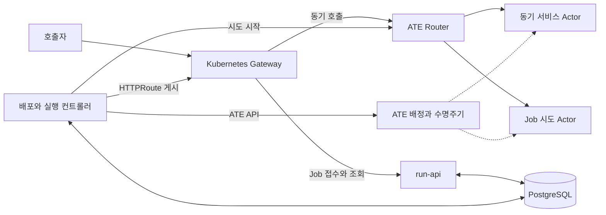
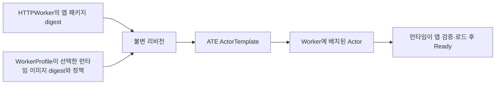

# Worker Platform 아키텍처

Worker Platform은 Kubernetes Gateway API로 워커를 호출하고, ATE 정책으로 Actor의 배치와 격리를 관리한다. 제품의 기본 배포 단위는 **공통 Actor 런타임 이미지와 별도 워커 앱 패키지**를 조합한 리비전이다. 앱 개발자는 처리 로직을 OCI 패키지로 게시한다. 첫 운영 릴리스는 동기 HTTP 호출과 실행 ID 하나로 상태·재인증·결과를 추적하는 단일 Job을 지원한다. [운영 요구사항](requirements.md)

## 현재 구현된 ATE 직접 배포

`worker-controller`는 v1alpha3의 `HTTPWorker`와 `WorkerProfile`을 감시하고 ATE Control API를 직접 호출한다. 앱 패키지 워커는 `HTTPWorker.spec.appPackage`와 `WorkerProfile.spec.runtimeImage`에 각각 OCI digest를 지정한다. 독립 이미지 워커는 `HTTPWorker.spec.image`를 사용한다. `workerctl`은 같은 배포 로직으로 v1alpha2 파일을 처리한다. [CRD 배포 가이드](ate-controller.md) · [Echo 패키지 예제](../examples/echo/README.md#공통-런타임으로-echo-패키지-배포)

옵션으로 활성화하는 단일 Job API는 PostgreSQL에 Run과 리비전을 고정하고, 시도별 ATE Actor의 UID와 최종 결과를 기록한다. Job 컨트롤러 복제본은 PostgreSQL의 WorkerPool별 슬롯 한도를 공유한다. 별도 ARM64 gVisor 풀에서 Echo로 Worker 장애 후 재시도와 세션 만료 후 HITL 재개를 검증했다. [현재 Job API](job-api.md) · [풀별 슬롯 설정](job-api.md#workerpool별-실행-슬롯) · [사이트 세션과 HITL](site-session-reauth.md)

## 실행 경로와 책임

| 구성요소 | 책임 |
| --- | --- |
| Kubernetes Gateway | 공개 호스트와 경로를 관리한다. 동기 요청을 ATE Router로, Job 제출·상태·결과 요청을 Job API Service로 보낸다. |
| Worker Platform | 승인된 실행 프로필을 해석하고 ATE ActorTemplate을 준비한다. 배포, HTTPRoute, Job 접수, 리비전 고정, 슬롯 예약, 시도 권한, 재시도, 결과, 사이트 로그인 상태를 관리한다. |
| ATE Control API와 WorkerPool | 풀과 자원 정책에 따라 실제 Worker를 배정한다. Actor의 부팅·재개·종료, 샌드박스 격리, egress 정책을 집행한다. |
| ATE Router | 허가된 주체의 요청을 지정 Actor로 전달한다. 설정된 요청 대기와 Actor 재개는 HTTP 전달 수명주기 안에서 처리한다. |
| 공통 Actor 런타임 | 고정된 앱 패키지를 검증하고 로드한다. 준비 확인과 호출 프로토콜을 제공하며 입력·세션을 앱에 전달하고 결과 또는 분류된 실패를 보고한다. |
| 워커 앱 패키지 | 작업 진입점과 필요한 의존성을 담는다. 앱은 입력으로 작업을 수행하고 결과를 반환하며, 재인증 이후 이어갈 지점과 외부 작업의 멱등 동작을 정의한다. |

Job을 활성화한 네임스페이스에는 `worker-controller`와 독립적으로 확장할 수 있는 `run-api`를 배포한다. 컨트롤러가 앱 리비전을 게시하고 큐를 소비한다. Run API는 PostgreSQL에서 접수와 조회를 처리하며, 모든 복제본은 같은 DB를 공유한다. Gateway는 앱의 동기 경로를 Router로, 공용 `/v1` 경로를 Run API Service로 연결한다. [배포와 전환 절차](job-api.md#개발계에서-켜기) · [단일 Job 실행 상세 설계](job-execution-design.md)

kagent에서 검증한 리비전·Actor 관리 패턴은 공개 ATE API로 구현한다. Testkube는 개발계 인수 시험의 선택 실행기로 활용한다. [상위 프로젝트 소스 검토](design-review.md)

## 워커 선언과 실행 프로필

- `HTTPWorker`는 앱 패키지의 OCI digest 참조, 실행 프로필 참조, 호출 모드를 선언한다. 동기 호출에는 승인된 호스트와 정확한 `POST` 경로를 지정한다. 운영자는 Gateway 리스너·호스트·메서드·경로 조합을 워커 하나에 배정한다. 입력·결과 스키마를 이용한 Job 접수는 단일 Job 실행 설계에 정의한다.
- 운영자가 관리하는 `WorkerProfile`은 승인된 공통 런타임 이미지와 실행 설정을 선택한다. 실행 설정에는 환경, Atespace, 물리 WorkerPool, 샌드박스 클래스, CPU 아키텍처, Actor의 CPU·메모리, 허용 목적지와 시크릿 참조가 포함된다. Job 접수·동시 실행 한도, 기한·보존 정책도 운영자가 정한다. 앱 팀은 자신에게 승인된 프로필을 참조한다.
- **리비전**은 워커 UID, 해석한 런타임 이미지와 앱 패키지의 digest 참조, 입력·결과 스키마, 러너 계약 버전과 유효 실행 설정을 정규화해 식별한다. ATE 템플릿의 참조·UID·불변 설정 digest를 함께 보관한다. 호스트·라우트 변경과 실시간 용량 한도는 배포 설정으로 관리한다.
- **Job**은 호출자가 제출한 단일 작업이다. **Run**은 실행 ID를 가진 접수 기록이고 **Attempt**는 그 실행을 처리하는 개별 시도다. **WorkerPool**은 실행 용량을 관리한다. **Worker**는 그 풀의 실행 Pod이며 **Actor**는 Worker 위에서 앱의 서비스를 제공하거나 Attempt를 처리하는 격리된 실행 인스턴스다.

### Echo 배포와 API 게시

kagent의 `Agent`는 인라인 또는 참조로 지정한 `AgentTemplate`을 `Harness`와 결합한다. Echo도 앱 정의와 실행 정책을 하나의 배포 명세에서 결합한다. [kagent 구성과 리비전 생성](https://github.com/kagent-dev/kagent/blob/558e3d761d8ed2b0d23bfef1867a9d1915210121/docs/architecture/configuration-and-compilation.md)

| 역할 | Echo의 구성 |
| --- | --- |
| 앱 정의 | `HTTPWorker.spec.appPackage`에 Echo OCI 패키지 digest를 지정한다. 패키지는 공통 런타임이 호출할 앱과 진입점을 담는다. |
| 실행 프로필 | `WorkerProfile`이 공통 런타임과 Atespace, WorkerPool, 샌드박스, CPU·메모리, egress를 지정한다. 운영자가 승인한 프로필을 앱이 참조한다. |
| 배포 | `HTTPWorker`의 이름을 `echo`로 정하고 `spec.profile`로 실행 프로필을 고른다. `spec.trigger`는 동기 호출 주소를, `spec.jobEnabled`는 Job 접수 여부를 지정한다. |

컨트롤러는 이 조합으로 ATE ActorTemplate과 서비스 Actor를 준비한다. Actor가 Ready가 되면 Gateway에 `POST /invoke` 라우트를 반영한다. Job API를 설치한 환경에서 `jobEnabled: true`를 지정하면 컨트롤러가 같은 리비전을 PostgreSQL에 게시한 뒤 `status.active`를 갱신한다. 공용 `POST /v1/workers/echo/runs`는 DB의 활성 리비전을 신규 Run에 고정한다. Job API와 공용 `/v1` 라우트는 플랫폼을 설치할 때 준비한다. [Echo 배포 명세](../examples/echo/packaged.yaml) · [Echo의 동기·Job 호출 예제](job-api.md#개발계에서-켜기)

### 공통 런타임의 앱 로드

앱 패키지는 OCI 레지스트리에 게시하는 아티팩트다. 패키지에는 앱 진입점, 러너 계약 버전과 그 앱의 실행에 필요한 파일을 담는다. 컨트롤러는 프로필의 런타임 이미지로 ActorTemplate을 만들고 선택된 앱 패키지 참조를 전달한다. 런타임은 시작 시 프로필이 허용한 HTTPS 레지스트리에서 매니페스트와 앱 레이어를 가져와 각 digest를 확인한 뒤 로드한다. 내부 레지스트리의 CA는 운영자가 프로필로 지정할 수 있다. 사이트 세션은 작업 호출 시점에 앱에 전달한다.

런타임이 `/readyz`, `/invoke`, `/attempt`를 제공한다. 앱 진입점은 표준 입력의 JSON을 처리해 표준 출력에 JSON을 쓰거나 실패를 종료 코드로 보고한다. 런타임은 `--check`로 초기화를 확인한 뒤 `/readyz`를 공개한다. 앱을 갱신할 때는 같은 런타임 이미지에 새 앱 패키지 digest를 지정해 새 리비전의 Actor를 배포한다. 각 Actor는 자신의 리비전에 고정된 패키지로 실행된다. [앱 패키지 빌드와 호출 계약](../examples/echo/README.md#공통-런타임으로-echo-패키지-배포)

### 풀·격리 정책 적용

| 실행 프로필 예 | 운영에서 독립적으로 정할 항목 |
| --- | --- |
| HTTP 스크래핑 | HTTP용 풀, 작은 CPU·메모리 할당량, 허용 사이트, 동시 실행 상한 |
| 브라우저 스크래핑 | 브라우저용 풀, 호환 브라우저·아키텍처, 더 큰 메모리, 인증 단계와 허용 사이트, 별도 동시 실행 상한 |
| 고용량 작업 | 사전 승인된 큰 자원 할당량과 전용 풀을 선택할 수 있다. Actor마다 슬롯 하나를 예약하고, 실제 배치 가능 여부는 ATE의 CPU·메모리로 확인한다. |

플랫폼은 WorkerPool의 리소스 라벨을 `ActorTemplate.workerSelector`로 적용한다. 운영자는 풀마다 고유한 라벨을 설정하고 풀을 재생성할 때 새 라벨을 사용한다. 풀 이름·네임스페이스가 재사용돼도 이전 리비전의 selector가 새 풀을 선택하지 않게 한다. ATE 클러스터와 Kubernetes 풀 UID를 함께 확인해 용량을 집계한다. Atespace의 권한은 별도로 검사한다. [ATE 템플릿과 풀 선택](https://ate.dev/docs/reference/api-guide/) · [ATE 권한](https://ate.dev/docs/guides/authorization/)

Job Actor는 고정된 공통 런타임 이미지에서 부팅하고 golden snapshot을 사용하지 않는다. 컨트롤러는 생성된 Actor의 정책을 확인한 뒤 첫 재개나 Router 호출을 허용한다. 기존 Run의 새 시도는 접수 당시 런타임 이미지와 앱 패키지를 사용하며 현재 허용 범위를 함께 검사한다. 실행 도중 접근 권한이 철회되면 기존 연결까지 종료하도록 Actor를 정리한다. [ATE EgressPolicy와 기존 연결](https://ate.dev/docs/guides/network-egress/)

동기 서비스 Actor의 자원은 ATE가 집행한다. Job의 슬롯은 플랫폼이 시도나 인증에 대해 예약한다. 두 경로가 물리 풀을 공유하면 동기 서비스의 자원도 그 풀의 실제 ATE 가용량에 영향을 준다. 지연 특성이 달라 용량을 독립 보장해야 하는 서비스에는 별도 풀을 지정한다. [Job 접수 한도와 슬롯](job-execution-design.md#접수-한도와-슬롯)

### 리비전 게시와 롤백

1. 컨트롤러는 `HTTPWorker` UID와 세대, 해석된 프로필을 기록한다. 같은 리비전의 템플릿을 다시 읽고 불변 설정과 저장한 UID를 확인한다. Actor를 생성하기 전에 관리 소유권을 기록한다.
2. 동기 서비스에는 새 리비전의 Actor를 준비한다. 앱 패키지 로드와 초기화가 완료된 뒤 비공개 `/readyz`를 확인한다. Job 전용 리비전은 실제 대상 풀에서 검증용 Actor로 같은 준비 절차를 수행하고 검증용 Actor를 회수한다. 검증 중에도 용량을 예약한다. 준비가 실패하면 활성 라우트와 게시 리비전은 이전 버전을 유지한다.
3. 동기 라우트는 대상 Actor가 준비된 뒤 소유권·UID·세대의 비교 후 갱신을 수행한다. 컨트롤러는 지정한 Gateway와 리스너에서 해당 HTTPRoute 세대의 `Accepted`, `ResolvedRefs`와 Gateway의 `Programmed`를 확인한다. 안전한 배포 확인 요청이 정의된 워커는 Gateway 경유 응답도 확인한다. 게시를 확정하기 전까지 Job 접수에는 DB의 이전 리비전을 사용한다.
4. Gateway와 DB의 갱신은 별도 작업이다. 컨트롤러는 이전과 대상 리비전, 갱신할 Route UID·세대를 저장해 재시작 후 상태를 이어서 확인한다. 라우트를 바꾼 뒤 실패하면 해당 변경이 여전히 자기 소유일 때만 이전 대상으로 복구한다. 동기 트래픽과 Job의 전환 시각은 다를 수 있다.
5. 롤백은 보존된 리비전과 서비스 Actor를 재사용한다. 새 Run은 새로 게시된 리비전을 사용하고 기존 Run은 처음 리비전에 고정된다. 정리기는 게시 행을 잠그고 활성 라우트, 롤백 대상, 미완료 Run의 참조를 확인한 뒤 리비전의 정리 의도를 기록한다. 워커 삭제 시 신규 접수와 자기 라우트를 닫고, 미완료 Run의 처분과 참조 해제가 끝날 때까지 리비전과 OCI 아티팩트를 보존한다. Run 조회와 결과 보존은 별도의 기한을 따른다.

### Gateway와 환경 경계

개발계와 운영계는 승인한 프로필, URL, 권한, 시크릿, 계정 세션을 구분한다. 운영계 승격에는 개발계에서 검증한 런타임 이미지와 앱 패키지의 digest를 사용하고, 실행 설정은 운영계 프로필로 해석한다. 컨트롤러는 이 프로젝트에서 소유권을 기록한 라우트와 Actor를 조정한다.

Gateway와 컨트롤러는 각자의 허가된 연결 신원으로 Router에 mTLS를 연결한다. 운영자는 Gateway의 클라이언트 인증서, Router CA와 SNI 검증을 위한 `BackendTLSPolicy`, 필요 범위의 `ReferenceGrant`를 설정한다. 동기 라우트는 들어온 `ate-target-actor`를 신뢰된 값으로 덮어쓰고, 공개 경로를 승인한 앱 호출 메서드와 경로로 한정한다. `/attempt`와 준비 확인 경로는 내부 호출에 예약한다. Job Actor는 컨트롤러가 관리하는 전용 Atespace에 둔다. 플랫폼이 소유한 라우트만 허용하도록 리스너와 HTTPRoute 쓰기 권한을 제한한다. 동기 호출자의 앱별 권한은 선택한 Gateway 구현체의 인증·인가 정책으로 확인한다. Job API는 검증한 호출자 토큰으로 앱과 환경 권한을 판단한다. 운영자·러너·인증 콜백에는 각각 허용한 신원과 사설 경로를 적용한다. [Gateway API TLS](https://gateway-api.sigs.k8s.io/guides/user-guides/tls/) · [헤더 수정](https://gateway-api.sigs.k8s.io/guides/user-guides/http-header-modifier/) · [교차 네임스페이스 참조](https://gateway-api.sigs.k8s.io/reference/api-types/referencegrant/)
