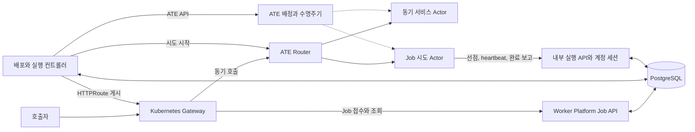

# Worker Platform 아키텍처

Worker Platform은 Kubernetes Gateway API로 워커를 호출하고, ATE 정책으로 워커의 배치와 격리를 관리한다. 첫 운영 릴리스에서 호출자는 단일 Job을 접수하고 실행 ID 하나로 상태·재인증·결과를 이어서 조회한다. HTTP 응답 안에서 끝나는 워커에는 Gateway에서 Actor로 직접 가는 경로도 제공한다. [운영 요구사항](requirements.md)

## 현재 공개 알파

`v0.1.0-alpha.1`의 `workerctl`은 파일로 받은 `HTTPWorker` v1alpha1을 검증해 AX Task와 HTTPRoute를 만든다. AX가 `Running`, Actor UID와 `Ready=True`를 보고하면 CLI가 소유권·UID·세대를 확인하고 라우트를 게시한다. 동일 digest와 설정으로 생성한 Task가 남아 있으면 롤백에서 재사용한다. Gateway의 상태 조회와 호출 확인은 운영자가 수행한다. 기존 Task의 보존과 정리도 운영자가 맡는다. [알파 배포 가이드](cluster-setup.md) · [CLI 배포 구현](../internal/platform/deploy.go) · [HTTPRoute 갱신 구현](../internal/platform/kubernetes.go)

아래는 첫 운영 릴리스의 목표 설계다. ATE 직접 배포, Job API, 계정 세션, 운영 대시보드는 구현과 인수 시험이 남아 있다. [확인한 범위와 출시 기준](design-review.md)

## 실행 경로와 책임

| 구성요소 | 책임 |
| --- | --- |
| Kubernetes Gateway | 공개 호스트와 경로를 관리한다. 동기 요청을 ATE Router로, Job 제출·상태·결과 요청을 Job API Service로 보낸다. |
| Worker Platform | 승인된 실행 프로필을 해석하고 ATE ActorTemplate을 준비한다. 배포, HTTPRoute, Job 접수, 리비전 고정, 슬롯 예약, 시도 권한, 재시도, 결과, 사이트 로그인 상태를 관리한다. |
| ATE Control API와 WorkerPool | 풀과 자원 정책에 따라 실제 Worker를 배정한다. Actor의 부팅·재개·종료, 샌드박스 격리, egress 정책을 집행한다. |
| ATE Router | 허가된 주체의 요청을 지정 Actor로 전달한다. 설정된 요청 대기와 Actor 재개는 HTTP 전달 수명주기 안에서 처리한다. |
| 워커 이미지와 러너 | 입력을 처리하고 결과 또는 분류된 실패를 보고한다. 재인증 단계가 있는 앱은 복구할 지점과 외부 작업의 멱등 동작을 정의한다. |

Worker Platform은 처음에 Go 서비스 하나로 배포한다. 공개 Job API와 내부 실행 API는 별도 리스너와 Service를 사용한다. 조정 루프와 모든 복제본은 하나의 PostgreSQL을 공유한다. 앱마다 Actor는 달라져도 Job URL은 같은 Job API를 가리킨다. 컨트롤러를 재시작해도 이미 게시된 동기 호출은 Gateway에서 Router로 전달된다. [단일 Job 실행 상세 설계](job-execution-design.md)

기준 배포기는 ATE API를 직접 호출한다. AX는 Task 관리가 필요한 설치에서 선택할 수 있으며 현재 알파는 AX를 사용한다. kagent에서 검증한 리비전·Actor 관리 패턴은 공개 ATE API를 통해 적용한다. Testkube는 개발계 인수 시험의 선택 실행기로 활용한다. [상위 프로젝트 소스 검토](design-review.md)

## 워커 선언과 실행 프로필

- `HTTPWorker`는 OCI 이미지 digest, 입력·결과 스키마, 실행 프로필 참조와 활성화할 호출 방식을 선언한다. 앱은 자신이 선택한 언어로 러너 계약을 구현한 이미지를 제공한다. 동기 호출을 열 때는 승인된 호스트와 정확한 `POST` 경로를 지정한다. 컨트롤러가 관리하는 영역에서는 Gateway 리스너·호스트·메서드·경로 조합을 워커 하나만 소유할 수 있다. 지속 배포용 Kubernetes 리소스와 공개 알파의 파일 형식은 별도 버전으로 관리한다.
- 운영자가 관리하는 `WorkerProfile`은 환경, Atespace, 물리 WorkerPool, 샌드박스 클래스, CPU 아키텍처, Actor의 CPU·메모리, 허용 목적지와 시크릿 참조를 정한다. Job 접수·동시 실행 한도, 기한·보존 정책도 운영자가 정한다. 앱 팀은 자신에게 승인된 프로필을 선택한다.
- **리비전**은 워커 UID, 이미지 digest, 입력·결과와 러너 계약 버전, 유효 실행 설정을 정규화해 식별한다. ATE 템플릿의 참조·UID·불변 설정 digest를 함께 보관한다. 호스트·라우트 변경과 실시간 용량 한도는 배포 설정으로 관리한다.
- **Job**은 호출자가 제출한 단일 작업이다. **Run**은 실행 ID를 가진 접수 기록이고 **Attempt**는 그 실행을 처리하는 개별 시도다. **Actor**는 해당 서비스를 제공하거나 시도를 처리하는 ATE 샌드박스이며, **Worker**는 ATE가 그 샌드박스를 배정한 실제 실행 노드의 Worker 리소스다.

### 풀·격리 정책 적용

| 실행 프로필 예 | 운영에서 독립적으로 정할 항목 |
| --- | --- |
| HTTP 스크래핑 | HTTP용 풀, 작은 CPU·메모리 할당량, 허용 사이트, 동시 실행 상한 |
| 브라우저 스크래핑 | 브라우저용 풀, 호환 브라우저·아키텍처, 더 큰 메모리, 인증 단계와 허용 사이트, 별도 동시 실행 상한 |
| 고용량 작업 | 사전 승인된 큰 자원 할당량과 전용 풀을 선택할 수 있다. Actor마다 슬롯 하나를 예약하고, 실제 배치 가능 여부는 ATE의 CPU·메모리로 확인한다. |

플랫폼은 WorkerPool의 리소스 라벨을 `ActorTemplate.workerSelector`로 적용한다. 운영자는 풀마다 고유한 라벨을 설정하고 풀을 재생성할 때 새 라벨을 사용한다. 풀 이름·네임스페이스가 재사용돼도 이전 리비전의 selector가 새 풀을 선택하지 않게 한다. ATE 클러스터와 Kubernetes 풀 UID를 함께 확인해 용량을 집계한다. Atespace의 권한은 별도로 검사한다. [ATE 템플릿과 풀 선택](https://ate.dev/docs/reference/api-guide/) · [ATE 권한](https://ate.dev/docs/guides/authorization/)

Job Actor는 OCI 이미지에서 부팅하고 golden snapshot을 사용하지 않는다. 컨트롤러는 생성된 Actor의 정책을 확인한 뒤 첫 재개나 Router 호출을 허용한다. 같은 이미지라도 다음 배포에서 정책을 바꿀 수 있다. 기존 Run의 새 시도는 접수 당시 리비전과 현재 허용 범위를 함께 검사한다. 실행 도중 접근 권한이 철회되면 기존 연결까지 종료하도록 Actor를 정리한다. [ATE EgressPolicy와 기존 연결](https://ate.dev/docs/guides/network-egress/)

동기 서비스 Actor의 자원은 ATE가 집행한다. Job의 슬롯은 플랫폼이 시도나 인증에 대해 예약한다. 두 경로가 물리 풀을 공유하면 동기 서비스의 자원도 그 풀의 실제 ATE 가용량에 영향을 준다. 지연 특성이 달라 용량을 독립 보장해야 하는 서비스에는 별도 풀을 지정한다. [Job 접수 한도와 슬롯](job-execution-design.md#접수-한도와-슬롯)

### 리비전 게시와 롤백

1. 컨트롤러는 `HTTPWorker` UID와 세대, 해석된 프로필을 기록한다. 같은 리비전의 템플릿을 다시 읽고 불변 설정과 저장한 UID를 확인한다. Actor를 생성하기 전에 관리 소유권을 기록한다.
2. 동기 서비스에는 새 리비전의 Actor를 준비해 비공개 `/readyz`를 확인한다. Job 전용 리비전은 실제 대상 풀에서 검증용 Actor로 러너의 준비 상태를 확인하고, 검증에 사용한 Actor를 회수한다. 검증 중에도 용량을 예약한다. 준비가 실패하면 활성 라우트와 게시 리비전은 이전 버전을 유지한다.
3. 동기 라우트는 대상 Actor가 준비된 뒤 소유권·UID·세대의 비교 후 갱신을 수행한다. 컨트롤러는 지정한 Gateway와 리스너에서 해당 HTTPRoute 세대의 `Accepted`, `ResolvedRefs`와 Gateway의 `Programmed`를 확인한다. 안전한 배포 확인 요청이 정의된 워커는 Gateway 경유 응답도 확인한다. 게시를 확정하기 전까지 Job 접수에는 DB의 이전 리비전을 사용한다.
4. Gateway와 DB의 갱신은 별도 작업이다. 컨트롤러는 이전과 대상 리비전, 갱신할 Route UID·세대를 저장해 재시작 후 상태를 이어서 확인한다. 라우트를 바꾼 뒤 실패하면 해당 변경이 여전히 자기 소유일 때만 이전 대상으로 복구한다. 동기 트래픽과 Job의 전환 시각은 다를 수 있다.
5. 롤백은 보존된 리비전과 서비스 Actor를 재사용한다. 새 Run은 새로 게시된 리비전을 사용하고 기존 Run은 처음 리비전에 고정된다. 정리기는 게시 행을 잠그고 활성 라우트, 롤백 대상, 미완료 Run의 참조를 확인한 뒤 리비전의 정리 의도를 기록한다. 워커 삭제 시 신규 접수와 자기 라우트를 닫고, 미완료 Run의 처분과 참조 해제가 끝날 때까지 리비전과 OCI 아티팩트를 보존한다. Run 조회와 결과 보존은 별도의 기한을 따른다.

### Gateway와 환경 경계

개발계와 운영계는 승인한 프로필, URL, 권한, 시크릿, 계정 세션을 구분한다. 운영계 승격에는 개발계에서 검증한 OCI digest를 사용하고, 실행 설정은 운영계 프로필로 해석한다. 컨트롤러는 이 프로젝트에서 소유권을 기록한 라우트와 Actor를 조정한다.

Gateway와 컨트롤러는 각자의 허가된 연결 신원으로 Router에 mTLS를 연결한다. 운영자는 Gateway의 클라이언트 인증서, Router CA와 SNI 검증을 위한 `BackendTLSPolicy`, 필요 범위의 `ReferenceGrant`를 설정한다. 동기 라우트는 들어온 `ate-target-actor`를 신뢰된 값으로 덮어쓰고, 공개 경로를 승인한 앱 호출 메서드와 경로로 한정한다. `/attempt`와 준비 확인 경로는 내부 호출에 예약한다. Job Actor는 컨트롤러가 관리하는 전용 Atespace에 둔다. 플랫폼이 소유한 라우트만 허용하도록 리스너와 HTTPRoute 쓰기 권한을 제한한다. 동기 호출자의 앱별 권한은 선택한 Gateway 구현체의 인증·인가 정책으로 확인한다. Job API는 검증한 호출자 토큰으로 앱과 환경 권한을 판단한다. 운영자·러너·인증 콜백에는 각각 허용한 신원과 사설 경로를 적용한다. [Gateway API TLS](https://gateway-api.sigs.k8s.io/guides/user-guides/tls/) · [헤더 수정](https://gateway-api.sigs.k8s.io/guides/user-guides/http-header-modifier/) · [교차 네임스페이스 참조](https://gateway-api.sigs.k8s.io/reference/api-types/referencegrant/)
