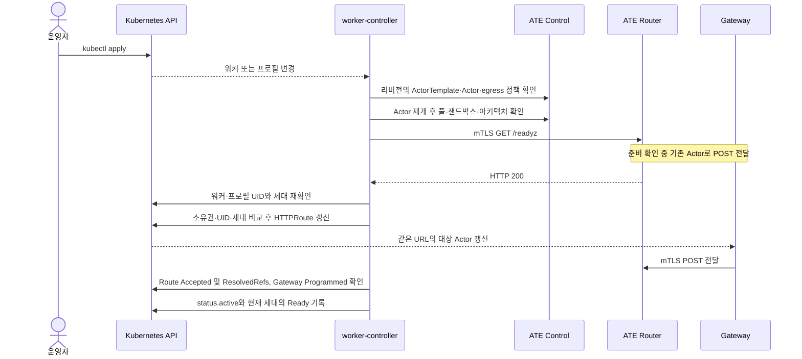

# Kubernetes CRD로 ATE에 배포

`worker-controller`는 적용된 `HTTPWorker`와 `WorkerProfile`을 감시한다. `HTTPWorker`에 이미지 digest와 호출 주소를, 같은 네임스페이스의 `WorkerProfile`에 Atespace·WorkerPool·CPU·메모리·egress 정책을 지정한다. 두 CRD의 API 버전은 `workerplatform.imprun.dev/v1alpha3`다. [HTTPWorker 예제](../examples/echo/httpworker.yaml) · [WorkerProfile 예제](../examples/echo/workerprofile.yaml)



## 개발계 설치

ARM64 gVisor를 지원하는 ATE 개발계와 Gateway API 구현체를 준비한다. 예제는 `wp-echo-example` 네임스페이스와 Atespace, `echo-arm64-dev` 풀, ClusterIP Gateway를 사용한다. 샌드박스 설정과 노드 라벨은 개발계 설치 값에 맞춘다. 공유 ATE 설치에서는 기존 Actor 템플릿의 풀 선택 조건과 가용 CPU를 확인한 뒤 시험 풀을 만든다. [Echo 개발계 준비](../examples/echo/README.md#개발계-준비)

아래는 저장소 루트의 POSIX 셸에서 실행한다. `KUBE_CONTEXT`와 `ATE_ADMIN_TOKEN_FILE`은 개발계와 Atespace 관리자 토큰을 가리킨다. `ATE_CA`와 `ROUTER_CA`는 각 서버 CA 파일이다. `ROUTER_CERT`와 `ROUTER_KEY`는 Router에서 허가한 개발계 클라이언트 인증서와 키다. `CONTROLLER_IMAGE`에는 컨트롤러를 빌드해 게시한 OCI digest 주소를 넣는다. [컨트롤러 이미지 레시피](../Dockerfile.controller)

```sh
k() { kubectl --context "$KUBE_CONTEXT" "$@"; }
ate_admin() { kubectl ate --context "$KUBE_CONTEXT" --token-file "$ATE_ADMIN_TOKEN_FILE" "$@"; }
ns=wp-echo-example

k apply -f deploy/crds
k wait --for=condition=Established --timeout=60s \
  crd/httpworkers.workerplatform.imprun.dev crd/workerprofiles.workerplatform.imprun.dev
k create -f examples/echo/namespace.yaml
ate_admin create atespace "$ns"
policy="$(mktemp)"
sed 's/:echo-deployer$/:worker-controller/' examples/echo/access-policy.yaml > "$policy"
ate_admin create access-policy -a "$ns" -f "$policy"
rm -f -- "$policy"
k create -f examples/echo/workerpool.yaml
k -n "$ns" create secret tls router-client --cert="$ROUTER_CERT" --key="$ROUTER_KEY"
k -n "$ns" create configmap ate-trust \
  --from-file="control-ca.crt=$ATE_CA" --from-file="router-ca.crt=$ROUTER_CA"
k -n ate-system create configmap wp-echo-example-router --from-file="ca.crt=$ROUTER_CA"
k create -f examples/echo/gateway.yaml
k -n "$ns" apply -f deploy/controller/rbac.yaml
k apply -f examples/echo/controller-access.yaml
k apply -f examples/echo/router-ingress.yaml

# 예제 Service 별칭으로 접속하고 Router의 실제 DNS 이름으로 TLS를 검증한다.
sed '/-router-url=/c\
            - -router-url=https://wp-echo-example-router.ate-system.svc:443\
            - -router-server-name=atenet-router.ate-system.svc' deploy/controller/deployment.yaml |
  k set image --local -f - controller="$CONTROLLER_IMAGE" -o yaml |
  k -n "$ns" apply -f -
k -n "$ns" rollout status deployment/worker-controller --timeout=90s
```

컨트롤러는 네임스페이스 하나를 감시한다. 같은 네임스페이스의 Gateway를 읽고 `HTTPRoute`를 게시한다. 다른 네임스페이스의 WorkerPool은 지정한 풀에 대한 `get` 권한으로 확인한다. 프로필과 Gateway 리스너는 운영자가 승인한다. 승인된 리스너에서 각 호스트·경로에 워커 하나를 배정한다. 컨트롤러와 Gateway는 Router에 접속할 때 각각 허가된 mTLS 신원을 제시한다. [컨트롤러 RBAC](../deploy/controller/rbac.yaml) · [개발 풀과 네트워크 접근 권한](../examples/echo/controller-access.yaml)

예제 Deployment는 복제본 하나를 사용한다. CA 또는 Router 클라이언트 인증서를 교체하면 `kubectl -n wp-echo-example rollout restart deployment/worker-controller`로 컨트롤러에 반영한다.

## 적용·업데이트·롤백

`ECHO_IMAGE_V1`, `ECHO_IMAGE_V2`는 `/readyz`와 `POST /invoke`를 구현한 ARM64 이미지의 OCI digest 주소다. 검증할 때는 두 버전의 응답이 구분되는 앱을 사용한다.

```sh
apply_echo() {
  sed "s|image: .*|image: $1|" examples/echo/httpworker.yaml | k apply -f -
}

wait_echo() {
  generation="$(k -n "$ns" get httpworker echo -o jsonpath='{.metadata.generation}')"
  k -n "$ns" wait --for="jsonpath={.status.active.generation}=$generation" \
    --timeout=120s httpworker/echo
}

k apply -f examples/echo/workerprofile.yaml
apply_echo "$ECHO_IMAGE_V1"
wait_echo
k -n "$ns" get httpworker echo -o yaml
```

별도 터미널에서 `kubectl -n wp-echo-example get svc -l gateway.networking.k8s.io/gateway-name=echo`로 Gateway Service 이름을 확인하고 `kubectl -n wp-echo-example port-forward svc/<이름> 8080:80`을 실행한다.

```sh
call_echo() {
  curl -fsS -H 'Host: echo.example.test' -H 'Content-Type: application/json' \
    --data '{"message":"echo-example"}' http://127.0.0.1:8080/invoke
}

call_echo
first_actor="$(k -n "$ns" get httpworker echo -o jsonpath='{.status.active.actorUID}')"
apply_echo "$ECHO_IMAGE_V2"
wait_echo
call_echo
apply_echo "$ECHO_IMAGE_V1"
wait_echo
test "$(k -n "$ns" get httpworker echo -o jsonpath='{.status.active.actorUID}')" = "$first_actor"
call_echo
```

새 배포가 게시됐는지는 `metadata.generation`, `status.active.generation`, `Ready` 조건의 `observedGeneration`과 `status`를 함께 확인한다. 프로필만 바뀌면 `status.observedProfile.generation`과 `status.active.profile.generation`이 변경을 보여준다. `status.active.actorUID`는 마지막으로 게시를 확인한 Actor이고, `worker`와 `workerPod`는 게시 시점의 배정이다.

리비전은 HTTPWorker의 UID와 유효 실행 설정으로 계산한다. 같은 HTTPWorker에 이전 digest와 실행 설정을 다시 적용하면 이전 Actor를 조회해 사용한다. 업데이트와 `HTTPWorker` 삭제 후에도 ATE의 이전 리비전은 남는다. 시험 계정을 정리할 때는 해당 Atespace 소유의 Actor와 ActorTemplate을 확인해 제거한다. `HTTPWorker`를 삭제하면 Kubernetes가 그 UID에 소속된 HTTPRoute를 정리한다. [Actor와 Atespace 정리 순서](../examples/echo/README.md#예제-정리)

## 개발계 검증

Kubernetes v1.36.6, Gateway API v1.6.1, agentgateway v1.7.0, ATE v1.0.0의 별도 ARM64 gVisor 풀에서 실행했다. 이미지 태그만 있는 명세는 API 서버에서 거부됐다. `kubectl apply`로 v1 → v2 → v1을 적용하는 동안 `POST http://echo.example.test/invoke`의 측정 요청 40건이 모두 HTTP 200을 반환했다.

| 적용 | 확인한 응답과 Actor |
| --- | --- |
| v1 | CRD 1세대가 게시된 후 v1 응답을 받았다. |
| v2 | 후보가 `RESUMING`인 동안 v1 응답과 기존 라우트 대상을 31회 확인했다. 후보가 `RUNNING`이고 준비 확인을 통과한 뒤 같은 URL에서 v2 응답을 받았다. |
| v1 롤백 | HTTPRoute UID가 유지됐고 첫 v1 Actor UID가 복원됐다. Atespace에는 같은 두 Actor만 남았다. |
