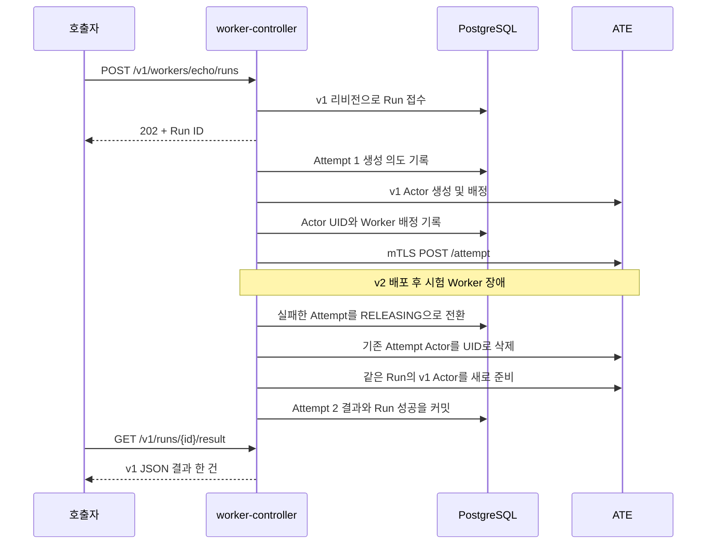

# 단일 Job 접수와 재시도

`HTTPWorker.spec.jobEnabled: true`를 적용하면 준비 후 게시된 워커 리비전으로 Job을 접수할 수 있다. `worker-controller`는 Run ID, JSON 입력, 불변 ActorTemplate의 UID와 유효 실행 설정을 PostgreSQL에 보관한다. 시도할 때마다 그 리비전으로 별도의 ATE Actor를 만들고, Actor UID와 배정된 Worker ID·Pod UID를 Attempt에 기록한다. [배포 컨트롤러](ate-controller.md) · [PostgreSQL 스키마](../internal/jobs/schema.sql)

리비전과 실행의 접수를 같은 트랜잭션에 기록하고, 원격 호출 전에 실행권을 저장하는 순서는 kagent의 세션과 예약 실행 코드를 참고했다. [kagent 세션 접수](https://github.com/kagent-dev/kagent/blob/dedcef228d064eaf595c7a02e72c0610b39167f5/go/core/internal/database/sessions.go#L103-L141) · [kagent 예약 실행](https://github.com/kagent-dev/kagent/blob/dedcef228d064eaf595c7a02e72c0610b39167f5/go/core/internal/controller/scheduledrun/controller.go#L130-L195)



## 개발계에서 켜기

별도 ARM64 gVisor 개발 풀과 Gateway를 준비하고 컨트롤러 배포 가이드의 CA, Router 클라이언트 인증서, 네임스페이스 RBAC를 설치한다. Job API를 쓸 네임스페이스에 PostgreSQL 17 접속 문자열 파일과 32자 이상의 무작위 토큰 파일을 준비하고, Job 코드를 포함한 컨트롤러 이미지의 digest를 사용한다. 컨트롤러가 PostgreSQL 접속 계정으로 스키마를 설치한다. [개발계 설치](ate-controller.md#개발계-설치) · [컨트롤러 이미지](../Dockerfile.controller)

```sh
k() { kubectl --context "$KUBE_CONTEXT" "$@"; }
ns=wp-echo-example
k -n "$ns" create secret generic worker-job-credentials \
  --from-file="dsn=$JOB_DSN_FILE" --from-file="token=$JOB_TOKEN_FILE"

sed '/-router-url=/c\
            - -router-url=https://wp-echo-example-router.ate-system.svc:443\
            - -router-server-name=atenet-router.ate-system.svc' deploy/controller/deployment.yaml |
  k patch --local -f - --type=json --patch-file examples/echo/jobs-controller-patch.yaml -o yaml |
  k set image --local -f - controller="$CONTROLLER_IMAGE" -o yaml |
  k -n "$ns" apply -f -
k -n "$ns" rollout status deployment/worker-controller --timeout=90s
k apply -f examples/echo/jobs-gateway.yaml
k apply -f examples/echo/workerprofile.yaml

sed -e "s|image: .*|image: $ECHO_IMAGE|" -e '/^  profile:/a\
  jobEnabled: true' examples/echo/httpworker.yaml | k apply -f -
k -n "$ns" wait --for=condition=Ready --timeout=120s httpworker/echo
```

`ECHO_IMAGE`는 `/attempt`를 포함한 Echo 이미지를 가리킨다. 개발계의 Gateway Service를 로컬 8080번으로 포트포워드한다. 이 예제의 토큰은 하나의 네임스페이스 내 Job 접수와 조회에 사용한다. [Gateway 예제](../examples/echo/jobs-gateway.yaml) · [Echo 러너](../cmd/echo/main.go)

```sh
auth="Authorization: Bearer $(cat "$JOB_TOKEN_FILE")"
host='Host: echo.example.test'
url=http://127.0.0.1:8080
receipt="$(curl -fsS -H "$host" -H "$auth" -H 'Idempotency-Key: echo-job-1' \
  -H 'Content-Type: application/json' --data '{"message":"hello"}' \
  "$url/v1/workers/echo/runs")"
id="$(printf '%s' "$receipt" | jq -r .runId)"
curl -fsS -H "$host" -H "$auth" "$url/v1/runs/$id"
# 상태가 SUCCEEDED가 되면 보존된 결과를 읽는다.
curl -fsS -H "$host" -H "$auth" "$url/v1/runs/$id/result"
```

## 구현된 계약

| 요청 | 응답 |
| --- | --- |
| `POST /v1/workers/{worker}/runs` | `202`와 `runId`, `revision`, `statusUrl`을 반환한다. 같은 워커 UID와 멱등 키를 보낸 요청은 JSONB 값과 선택적 `Site-Session-Ref`가 같으면 최초 영수증을, 달라지면 `409`를 반환한다. |
| `GET /v1/runs/{id}` | 고정된 리비전, 상태, Attempt 번호·Actor UID·Worker 배정과 `occupiedSlots`를 반환한다. 재인증 대기 중에는 `reauth`도 반환한다. |
| `GET /v1/runs/{id}/result` | 성공한 Run의 JSON 결과 한 건을 `200`으로 반환한다. 결과 확정 전에는 `409`를 반환한다. |

사이트 로그인 상태를 사용하는 앱은 세션 참조를 지정하고 재인증을 거쳐 동일한 Run을 이어갈 수 있다. [사이트 세션과 HITL 예제](site-session-reauth.md)

HTTP JSON 입력과 결과는 각각 64 KiB까지 허용한다. 클라이언트는 중복 속성 없이 JSON을 보낸다. 러너는 내부 `POST /attempt`에서 `{"runId":"...","attempt":1,"input":{...}}`를 받아 성공 시 HTTP 200과 JSON을 반환한다. Router 호출은 mTLS를 사용한다. 공개 Gateway의 Job 경로는 `/v1`이다.

기본 Run 기한은 5분이며 장애로 끝나는 시도는 최대 두 번이다. 세션 만료 시도는 인증 대기로 이어진다. 전송이 실패하거나 Worker 배정이 끊기면 이전 Attempt Actor의 삭제를 확인한 뒤 새 Actor로 시도한다. 컨트롤러가 중단되면 PostgreSQL의 작업 lease가 만료된 시도를 다음 실행기가 회수한다. 만료된 lease로는 새 상태나 결과를 기록할 수 없다. 성공 결과는 Run ID를 기본 키로 저장하고, Attempt 정리와 Run의 최종 상태를 같은 DB 트랜잭션에서 확정한다. 외부 서비스에서 발생하는 부수 효과에는 앱이 Run ID를 멱등 키로 사용한다.

## ARM64 gVisor 개발계 검증

별도 테스트 Gateway에서 v1 Job을 접수하고 앱이 첫 번째 Attempt에 진입했음을 확인했다. 같은 워커를 v2로 업데이트한 뒤 동기 경로에서 v2 응답을 받았다. 이때 기존 멱등 키로 다시 제출하면 최초 Run ID와 v1 리비전을 받았고, 같은 키의 입력을 바꾸면 HTTP 409를 받았다.

첫 Attempt가 진행 중일 때 해당 Worker Pod를 UID 사전조건으로 강제 종료했다. 첫 Attempt는 `worker_assignment_lost`로 실패했다. 두 번째 Attempt는 다른 Worker와 새 Actor UID로 실행되어, 최초 Run ID의 결과 API에서 v1 JSON을 반환했다. PostgreSQL에서 Run 1건, Attempt 2건, 결과 1건을 확인했으며 종료 후 시도용 Actor가 0개였다.
