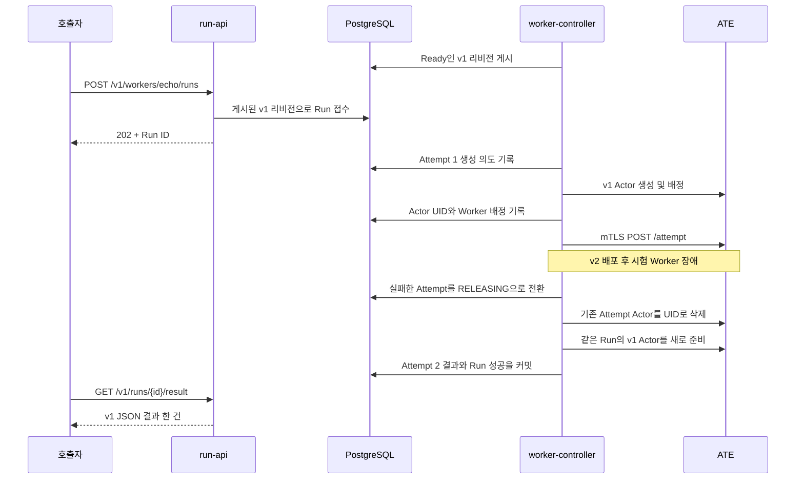

# 단일 Job 접수와 재시도

`HTTPWorker.spec.jobEnabled: true`를 적용하면 준비 후 게시된 워커 리비전으로 Job을 접수할 수 있다. `worker-controller`는 ATE Actor가 Ready이고 동기 HTTPRoute가 반영된 뒤, 활성 리비전과 불변 ActorTemplate UID를 PostgreSQL에 게시한다. `run-api`는 활성 리비전을 읽는 트랜잭션에서 Run ID와 JSON 입력을 저장한다. 패키지 워커는 공통 런타임 이미지와 OCI 앱 패키지의 두 digest를 리비전에 고정한다. 컨트롤러는 시도마다 해당 리비전으로 별도의 ATE Actor를 만들고, Actor UID와 배정된 Worker ID·Pod UID를 Attempt에 기록한다. [배포 컨트롤러](ate-controller.md) · [리비전 게시 스키마](../internal/jobs/schema_publications.sql)

리비전과 실행의 접수를 같은 트랜잭션에 기록하고, 원격 호출 전에 실행권을 저장하는 순서는 kagent의 세션과 예약 실행 코드를 참고했다. [kagent 세션 접수](https://github.com/kagent-dev/kagent/blob/dedcef228d064eaf595c7a02e72c0610b39167f5/go/core/internal/database/sessions.go#L103-L141) · [kagent 예약 실행](https://github.com/kagent-dev/kagent/blob/dedcef228d064eaf595c7a02e72c0610b39167f5/go/core/internal/controller/scheduledrun/controller.go#L130-L195)



## 개발계에서 켜기

별도 ARM64 gVisor 개발 풀과 Gateway를 준비하고 컨트롤러 배포 가이드의 CA, Router 클라이언트 인증서, 네임스페이스 RBAC를 설치한다. Job API를 쓸 네임스페이스에 PostgreSQL 17 접속 문자열 파일과 32자 이상의 무작위 토큰 파일을 준비한다. `CONTROLLER_IMAGE`와 `RUN_API_IMAGE`에는 같은 버전에서 빌드한 두 이미지의 digest 참조를 지정한다. 두 Deployment는 같은 DB와 네임스페이스를 사용한다. 시작 시 PostgreSQL에 배타 잠금을 잡고 스키마를 설치한다. [개발계 설치](ate-controller.md#개발계-설치) · [컨트롤러 이미지](../Dockerfile.controller) · [Run API 이미지](../Dockerfile.run-api)

Echo 배포 가이드의 패키지 빌드 단계에서 `runtime_image`, `PACKAGE_HOST`, `package_v1`, `package_v2`를 준비한다. 비공개 레지스트리 CA를 사용하면 `WorkerProfile.spec.appRegistryCA`도 설정한다. [런타임과 Echo 패키지 준비](../examples/echo/README.md#공통-런타임으로-echo-패키지-배포)

```sh
k() { kubectl --context "$KUBE_CONTEXT" "$@"; }
ns=wp-echo-example
k -n "$ns" create secret generic worker-job-credentials \
  --from-file="dsn=$JOB_DSN_FILE" --from-file="token=$JOB_TOKEN_FILE"

sed '/-router-url=/c\
            - -router-url=https://wp-echo-example-router.ate-system.svc:443\
            - -router-server-name=atenet-router.ate-system.svc' deploy/controller/deployment.yaml |
  k patch --local -f - --type=json --patch-file examples/echo/jobs-controller-patch.yaml -o yaml |
  k set image --local -f - controller="$CONTROLLER_IMAGE" -o yaml |
  k -n "$ns" apply -f -
k -n "$ns" rollout status deployment/worker-controller --timeout=90s
k set image --local -f deploy/run-api/deployment.yaml api="$RUN_API_IMAGE" -o yaml |
  k -n "$ns" apply -f -
k -n "$ns" rollout status deployment/run-api --timeout=90s
k apply -f examples/echo/jobs-gateway.yaml
```

위 Service와 `/v1` 라우트는 예제 네임스페이스의 앱이 함께 사용한다. 한 번 준비한 뒤, 아래처럼 `WorkerProfile`과 `jobEnabled: true`를 지정한 Echo `HTTPWorker`를 한 번에 적용한다. 컨트롤러가 ATE Actor를 준비하고 동기 라우트와 Job 리비전을 게시한다. [앱과 실행 프로필의 결합](architecture.md#echo-배포와-api-게시)

```sh
apply_job_package() {
  sed -e "s|runtimeImage: .*|runtimeImage: $runtime_image|" \
      -e "s|hostname: packages.example.test|hostname: $PACKAGE_HOST|" \
      -e "s|appPackage: .*|appPackage: $1|" \
      -e '/^  appPackage:/a\
  jobEnabled: true' examples/echo/packaged.yaml | k apply -f -
}

wait_job_revision() {
  generation="$(k -n "$ns" get httpworker echo -o jsonpath='{.metadata.generation}')"
  k -n "$ns" wait --for="jsonpath={.status.active.generation}=$generation" \
    --timeout=120s httpworker/echo
}

apply_job_package "$package_v1"
wait_job_revision
```

개발계 Gateway Service를 로컬 8080번으로 포트포워드한다. 이 예제의 토큰은 하나의 네임스페이스 내 Job 접수와 조회에 사용한다. Echo 앱은 Job의 결과에 `message`, `version`, `runId`, `attempt`를 반환한다. [Gateway 예제](../examples/echo/jobs-gateway.yaml) · [Echo 앱](../examples/echo/app/main.go)

```sh
auth="Authorization: Bearer $(cat "$JOB_TOKEN_FILE")"
host='Host: echo.example.test'
url=http://127.0.0.1:8080
# 같은 Echo 배포의 동기 호출
curl -fsS -H "$host" -H 'Content-Type: application/json' \
  --data '{"message":"hello"}' "$url/invoke"

# 공용 Job API로 같은 Echo 배포에 작업 접수
receipt="$(curl -fsS -H "$host" -H "$auth" -H 'Idempotency-Key: echo-job-1' \
  -H 'Content-Type: application/json' --data '{"message":"hello"}' \
  "$url/v1/workers/echo/runs")"
id="$(printf '%s' "$receipt" | jq -r .runId)"
curl -fsS -H "$host" -H "$auth" "$url/v1/runs/$id"
# 상태가 SUCCEEDED가 되면 보존된 결과를 읽는다.
curl -fsS -H "$host" -H "$auth" "$url/v1/runs/$id/result"
```

동기 호출은 Echo의 `message`와 `version`을 바로 반환한다. Job 접수 응답의 `revision`은 접수 시점에 PostgreSQL에 게시된 값이며, 완료 결과는 저장한 Run ID로 조회한다.

Worker 장애를 재현할 때는 전용 풀에 Worker 두 개를 준비하고 Job 입력에 `"waitSeconds": 75`를 추가한다. 이 값은 Echo의 첫 Attempt에만 적용된다. Run의 `attempts[0]`에서 `RUNNING` 상태와 Worker Pod UID를 확인한 뒤 `apply_job_package "$package_v2"`와 `wait_job_revision`을 실행한다. 현재 배포가 v2를 응답하는 동안, 해당 UID가 가리키는 시험 Worker를 종료한다. 같은 Run ID를 조회하면 새 Actor에서 재시도한 v1 결과를 확인할 수 있다.

### 기존 Job API에서 전환

기존 DB와 Secret을 사용해 API Deployment를 먼저 띄운다. 컨트롤러에는 예제의 새 Job 패치를 적용하고 `-job-listen`과 `-job-token-file`은 Run API 배포 설정으로 옮긴다. 재인증을 쓰는 경우에는 양쪽에 같은 세션 암호화 키를 주고 제공자 토큰을 Run API에 설정한다. 이전 컨트롤러에 설치했던 플래그가 남아 있으면 선언에서 제거한다. [재인증 배포 설정](site-session-reauth.md#개발계-설정)

새 컨트롤러는 기존 `status.active.revision`과 저장된 ActorTemplate 리비전이 일치하는 앱부터 Job 게시를 복원한다. 전환 대상 앱의 리비전이 `wp_job_publications`에 활성화됐는지 확인한 뒤 `jobs-gateway.yaml`을 적용한다. 기존 Service 이름과 공개 URL을 사용하며, 기존 Run·Attempt·결과는 같은 DB에서 조회한다. 컨트롤러 교체부터 Service 전환까지 Job API에는 짧은 접속 중단이 생길 수 있다.

## 구현된 계약

| 요청 | 응답 |
| --- | --- |
| `POST /v1/workers/{worker}/runs` | `202`와 `runId`, `revision`, `statusUrl`을 반환한다. 같은 워커 UID와 멱등 키를 보낸 요청은 JSONB 값과 선택적 `Site-Session-Ref`가 같으면 최초 영수증을, 달라지면 `409`를 반환한다. |
| `GET /v1/runs/{id}` | 고정된 리비전, 상태, Attempt 번호·Actor UID·Worker 배정과 `occupiedSlots`를 반환한다. 재인증 대기 중에는 `reauth`도 반환한다. |
| `GET /v1/runs/{id}/result` | 성공한 Run의 JSON 결과 한 건을 `200`으로 반환한다. 결과 확정 전에는 `409`를 반환한다. |

사이트 로그인 상태를 사용하는 앱은 세션 참조를 지정하고 재인증을 거쳐 동일한 Run을 이어갈 수 있다. [사이트 세션과 HITL 예제](site-session-reauth.md)

HTTP JSON 입력과 결과는 각각 64 KiB까지 허용한다. 클라이언트는 중복 속성 없이 JSON을 보낸다. 러너는 내부 `POST /attempt`에서 `{"runId":"...","attempt":1,"input":{...}}`를 받아 성공 시 HTTP 200과 JSON을 반환한다. Router 호출은 mTLS를 사용한다. 공개 Gateway의 Job 경로는 `/v1`이다.

기본 Run 기한은 5분이며 장애로 끝나는 시도는 최대 두 번이다. 세션 만료 시도는 인증 대기로 이어진다. 전송이 실패하거나 Worker 배정이 끊기면 이전 Attempt Actor의 삭제를 확인한 뒤 새 Actor로 시도한다. 컨트롤러가 중단되면 PostgreSQL의 작업 lease가 만료된 시도를 다음 실행기가 회수한다. 만료된 lease로는 새 상태나 결과를 기록할 수 없다. 성공 결과는 Run ID를 기본 키로 저장하고, Attempt 정리와 Run의 최종 상태를 같은 DB 트랜잭션에서 확정한다. 외부 서비스에서 발생하는 부수 효과에는 앱이 Run ID를 멱등 키로 사용한다.

## WorkerPool별 실행 슬롯

한 ATE 설치의 Job 컨트롤러 복제본은 같은 PostgreSQL을 사용한다. 운영자는 복제본을 한도 지원 버전으로 배포한 뒤 `wp_job_pool_limits`에 한도를 설정한다. 키는 `WorkerProfile.spec.workerPool`이 가리키는 Kubernetes `namespace/name`이다. 같은 풀을 가리키는 여러 프로필이나 워커 네임스페이스가 하나의 한도를 공유한다. 한도는 현재 DB 값으로 적용하고 Run의 앱 리비전은 접수 당시 값으로 유지한다.

```sql
INSERT INTO wp_job_pool_limits (worker_pool, max_slots)
VALUES ('ate-system/echo-arm64-dev', 2), ('ate-system/echo-arm64-dev-b', 1)
ON CONFLICT (worker_pool) DO UPDATE SET max_slots = EXCLUDED.max_slots;
```

`max_slots`가 `NULL`이거나 설정 행이 없으면 풀별 상한 없이 실행한다. `0`은 신규 슬롯 예약을 멈춘다. 기존 점유 수보다 낮은 값으로 변경하면 점유 수가 새 한도 밑으로 내려갈 때 예약을 재개한다. 복제본마다 풀별로 하나씩 Run을 진행할 수 있으므로, 여러 슬롯을 동시에 사용하려면 그만큼 실행 가능한 복제본이 필요하다. [스키마 및 기존 리비전 마이그레이션](../internal/jobs/schema_pool_slots.sql)

풀 한도가 찬 경우에도 Job 제출은 `202`로 접수되고 Run은 슬롯 0개로 큐에서 기다린다. 스케줄러는 포화된 풀의 대기 Run을 건너뛴다. Actor 생성 전에 풀 한도 행을 잠가 사용량을 다시 계산하고, Attempt 기록과 예약을 같은 트랜잭션에서 커밋한다. `STARTING`, `RUNNING`, `RELEASING`이 슬롯을 점유한다. Actor 삭제를 확인한 뒤 슬롯이 반환되며, HITL 대기 상태의 점유 수는 0이다. [예약 확인](../internal/jobs/pool_slots.go) · [상태 전이](../internal/jobs/attempts.go)

### 풀 두 개와 복제본 두 개 검증

별도 ARM64 gVisor 풀 두 개와 Job 컨트롤러 복제본 두 개에서 각 풀에 Echo Run을 3건씩 제출했다. A 풀의 두 Run이 실행 중이고 세 번째 Run이 `QUEUED`인 동안 B 풀 Run이 성공했다. 모든 제출은 HTTP `202`로 접수됐다.

| 풀 | 설정 한도 | Attempt 예약 이력의 최대 점유 | 완료 후 점유 |
| --- | ---: | ---: | ---: |
| `ate-system/echo-arm64-dev` | 2 | 2 | 0 |
| `ate-system/echo-arm64-dev-b` | 1 | 1 | 0 |

DB와 ATE의 Job Actor 배정을 117회 관찰하고, 전체 Attempt의 예약 시작·반환 시각도 대조했다. 6개 Run에서 Attempt와 결과가 각각 한 건씩 생성됐고 완료 뒤 Job Actor는 0개였다. 마이그레이션은 기존 리비전에서 두 풀을 채웠으며 먼저 저장해 둔 Run과 결과 2건을 보존했다. [PostgreSQL 예약 경합 테스트](../internal/jobs/pool_slots_test.go)

## ARM64 gVisor 개발계 검증

### 분리한 Run API와 Echo 전환

2026년 11월 23일, 별도 ARM64 gVisor Worker 두 대와 `run-api` 복제본 두 개에서 시험했다. 같은 Gateway의 `/invoke`는 ATE Router를, `/v1`은 Run API Service를 사용했다. 공통 런타임 이미지 digest를 고정하고 Echo 앱 패키지 digest를 바꿨다. 새 패키지의 준비 검사는 4초 지연으로 대기 구간을 만들었다.

| 검증 | 관찰 결과 |
| --- | --- |
| 준비 중 접수와 동기 호출 | 새 세대가 `Ready=False`인 동안 `/invoke`에서 v1을 받았고, 새 Job `7973ef4d-bc7d-444c-a901-958fe176891f`는 v1 리비전으로 `202` 접수됐다. 전환 관측 중 동기 호출은 v1 13건을 반환했다. |
| 게시 후 전환 | HTTPRoute UID와 URL이 유지됐고 `/invoke`는 v2를 반환했다. 새 Job `1c7b1b97-2d9b-4ca2-a2f5-3a69f5e1c255`는 PostgreSQL에 게시된 v2로 접수됐다. |
| 기존 Run 재조회 | 원래 멱등 키로 같은 입력을 다시 보내 기존 Run `fbe938c2-8a8d-4d30-a213-60a36bd42b35`를 받았다. 입력을 바꿔 같은 키를 보내면 `409`였다. 기존 Run ID로 조회한 v1 결과는 한 건이었다. |
| 결과와 슬롯 | v1·v1·v2로 접수한 세 Run이 결과를 각각 한 건씩 남겼다. 완료 뒤 Job Actor와 점유 슬롯은 모두 0개였다. |

시험 노드의 CPU 예약 여유가 작아 전용 Worker Pod의 요청량을 2m로 설정했다. Actor 배치 용량은 Worker당 60m였다. 시험 Atespace와 풀을 회수한 뒤 기존 Actor 17개의 UID·상태·Worker 배정이 시험 전과 일치했다.

### 공통 런타임과 Echo 앱 패키지

전용 Worker 두 개로 시험했다. 런타임 이미지 digest `sha256:b689b5c190cd…`를 고정하고 Echo 패키지 digest만 `8c932b0c8b59…`에서 `6fa63f5b9ea7…`로 바꿨다. 첫 Attempt가 v1을 실행 중일 때 Gateway에서 새 배포의 v2 응답을 확인했고, PostgreSQL의 해당 Run은 v1 ActorTemplate과 패키지를 계속 가리켰다.

| 확인 대상 | 관찰 결과 |
| --- | --- |
| Run `8ef0591f-cd37-4c99-8ce3-563b51adf8cd` | v1 리비전으로 `202` 접수됐다. v2 배포 뒤 같은 멱등 키로 접수했을 때 같은 Run ID와 v1 리비전을 받았다. |
| Attempt 1 | Actor `cfc9f612-0ae5-45cf-84c2-7ae28d2506d9` 안에서 Echo 프로세스가 실행 중이었다. 배정된 시험 Worker만 종료했고 `worker_assignment_lost`로 실패했다. |
| Attempt 2 | 살아 있는 다른 Worker에서 새 Actor `f2cede7e-4714-4274-8e86-e54f9f7bff52`로 실행됐다. 같은 Run ID의 결과를 두 번 조회해 두 응답이 모두 `version: v1`, `attempt: 2`임을 확인했다. |
| 결과와 자원 | PostgreSQL에서 Run 1건, Attempt 2건, 결과 1건을 확인했다. 완료된 Run의 점유 슬롯과 시도용 Actor는 각각 0개였다. |

### 독립 이미지 검증

별도 테스트 Gateway에서 v1 Job을 접수하고 앱이 첫 번째 Attempt에 진입했음을 확인했다. 같은 워커를 v2로 업데이트한 뒤 동기 경로에서 v2 응답을 받았다. 이때 기존 멱등 키로 다시 제출하면 최초 Run ID와 v1 리비전을 받았고, 같은 키의 입력을 바꾸면 HTTP 409를 받았다.

첫 Attempt가 진행 중일 때 해당 Worker Pod를 UID 사전조건으로 강제 종료했다. 첫 Attempt는 `worker_assignment_lost`로 실패했다. 두 번째 Attempt는 다른 Worker와 새 Actor UID로 실행되어, 최초 Run ID의 결과 API에서 v1 JSON을 반환했다. PostgreSQL에서 Run 1건, Attempt 2건, 결과 1건을 확인했으며 종료 후 시도용 Actor가 0개였다.
