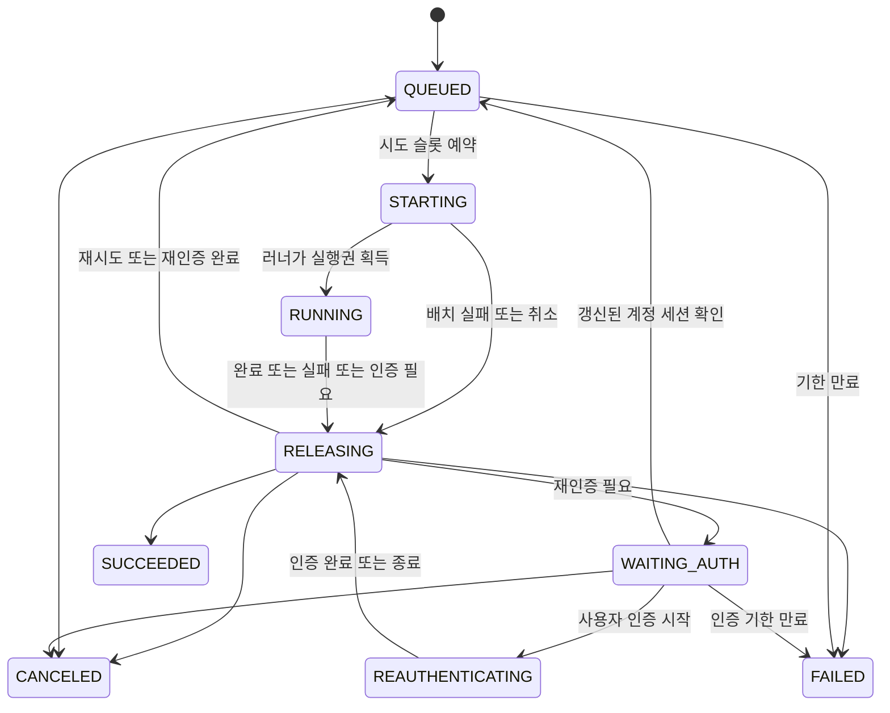
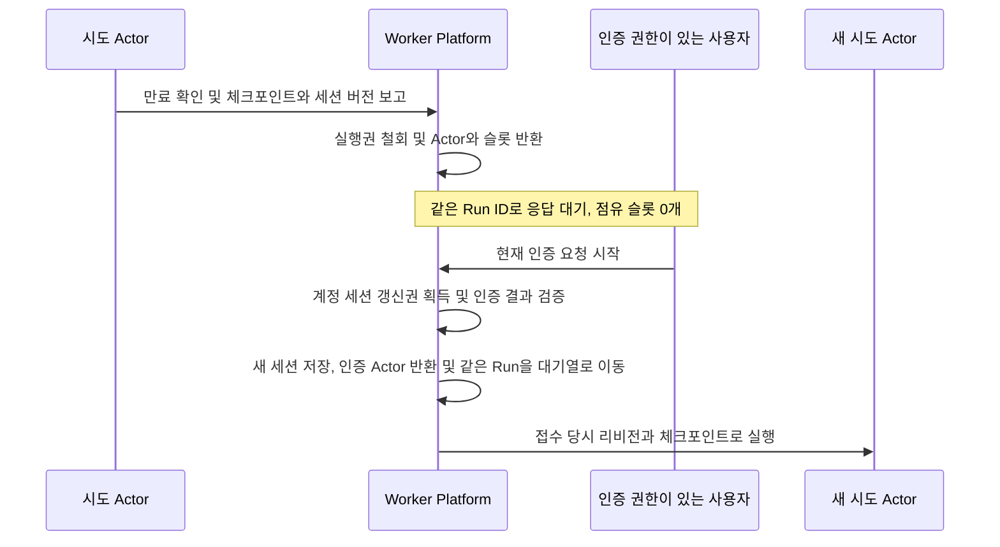

# 단일 Job 실행 상세 설계

Worker Platform은 Job의 접수를 PostgreSQL에 보관하고, ATE에서 시도별 Actor를 만들어 작업을 수행한다. 호출자가 보는 Run ID와 리비전은 첫 접수부터 재시도·HITL을 거쳐 완료될 때까지 유지된다. 실행 기록과 결과는 Actor가 종료된 뒤에도 조회할 수 있다. [아키텍처](architecture.md) · [운영 요구사항](requirements.md)

현재 구현은 단일 Job 접수·조회와 Actor 정리 후 재시도, 사이트 세션 재인증을 지원한다. 아래의 설계는 러너 실행권과 인증용 Actor까지 포함하는 운영 릴리스의 목표다. [현재 Job API와 배포](job-api.md) · [사이트 세션과 재인증](site-session-reauth.md)

## 공개 API와 실행 소유권

아래 경로와 응답은 첫 운영 릴리스에서 OpenAPI로 고정할 계약이다. Job API는 Gateway가 허용한 호스트와 토큰의 환경 권한을 대조한다. 해당 환경에 설정한 토큰 발급자·서명·대상·만료를 확인하고, 발급자에게 등록된 앱 식별자와 테넌트 권한을 대조한다.

| 요청 | 응답과 동작 |
| --- | --- |
| `POST /v1/workers/{worker}/runs` | `Idempotency-Key`와 JSON 입력을 받는다. 선택한 리비전, 입력과 권한 범위를 커밋하면 `202 Accepted`, `runId`, 상태 URL을 반환한다. `Location`은 상태 URL을 가리킨다. 같은 키·입력은 같은 ID를 반환하고, 같은 키·다른 입력은 `409`다. 접수 한도가 찬 신규 요청은 `429`다. |
| `GET /v1/runs/{id}` | 상태, 접수 당시 리비전, 시도 번호와 대기 사유를 반환한다. 실행에 성공했으면 결과 URL을, 재인증할 권한이 있는 사용자에게는 현재 인증 요청 ID를 표시한다. |
| `GET /v1/runs/{id}/result` | `SUCCEEDED`의 보존된 JSON 결과 한 건을 `200`으로 반환한다. 다른 상태는 상태·사유를 담은 `409`다. 실행 기록이 남아 있는 성공 Run에서 결과 보존 기한이 지났으면 `410`이다. |
| `POST /v1/runs/{id}/cancel` | 승인된 취소를 기록하고 현재 상태를 `202`로 반환한다. 정리 중에는 `RELEASING`으로 조회할 수 있다. 같은 취소는 추가 전이를 만들지 않는다. 성공이나 실패가 이미 확정된 Run에는 `409`를 반환한다. |
| `POST /v1/runs/{id}/reauth/{requestId}/start` | 해당 계정의 재인증 권한을 가진 사용자가 현재 활성 요청의 인증을 시작한다. 동일 요청의 재전송에는 기존 인증 시작 영수증을 반환한다. 다른 Run이 같은 계정을 갱신 중이면 `409`와 대기 사유를 반환한다. 완료 콜백은 검증된 사설 인증 경로에서 받는다. |

누락된 멱등 키나 잘못된 JSON은 `400`, 인증 실패는 `401`, 조회할 수 있는 리소스에 대한 동작 권한 부족은 `403`, 미등록 또는 다른 앱·환경의 Run은 `404`로 처리한다. 입력 크기 초과는 `413`, 리비전 스키마 위반은 `422`, 저장소에 접근하거나 커밋을 확인할 수 없는 경우는 `503`이다. 상태·결과·운영 조회는 DB 또는 읽기 전용 ATE API에서 처리한다.

### 접수 트랜잭션

1. 인증된 테넌트·환경·호출 앱과 논리 워커 UID로 범위를 확정한다. 암묵적 기본값을 붙이기 전 입력과 `sessionRef`를 정규화해 해시를 계산한다. JSON은 RFC 8785의 I-JSON 범위를 적용한다. 중복 속성을 거부하고 정확한 큰 정수가 필요한 입력은 스키마에서 문자열로 표현한다. [JSON Canonicalization Scheme](https://www.rfc-editor.org/rfc/rfc8785.html)
2. `(테넌트, 환경, 앱, 워커 UID, 멱등 키)` 유일 키의 접수 영수증 행을 `INSERT … ON CONFLICT DO NOTHING`으로 선점한다. 충돌하면 `READ COMMITTED`의 다음 문장에서 영수증을 읽는다. 해시가 같으면 저장된 ID를, 다르면 `409`를 반환한다. 접수 당시의 영수증을 확인한 뒤 새 리비전과 여유 용량을 볼 필요가 없다. [PostgreSQL 트랜잭션 격리](https://www.postgresql.org/docs/18/transaction-iso.html#XACT-READ-COMMITTED)
3. 신규 요청만 게시 행을 잠근 뒤 리비전을 고정하고 해당 스키마, 현재 계정 권한, 풀·앱 접수 한도를 확인한다. Run과 접수 영수증을 같은 트랜잭션에서 커밋한다. 접수를 거부한 트랜잭션은 영수증도 롤백한다. 응답이 유실되거나 커밋 여부가 불명확하면 호출자는 같은 키로 동일한 접수 영수증을 확인한다.
4. 미완료 Run의 키는 기한이 지나도 재사용하지 않는다. 종료 Run의 멱등 키·결과·메타데이터 보존 기간은 공개 계약에 명시한다. 이름이 같은 워커를 삭제 후 재등록하면 새 UID를 발급한다. 이전 실행은 Run ID와 소유 범위로 조회한다.

## 상태와 영속 데이터

`RELEASING`은 종료 의도와 다음 상태를 저장한 뒤 Actor와 슬롯을 회수하는 단계다. 슬롯을 점유했던 Run은 회수가 확인된 뒤 대기 또는 종료 상태로 들어간다. 실행 기한은 접수 시 고정하며, 배치 준비·시도 lease·사용자 응답 기한을 별도로 둔다. 상태나 lease의 유효성은 필요한 행을 잠근 뒤 DB 시각으로 판단한다.

| 레코드 | 저장할 값과 제약 |
| --- | --- |
| 리비전과 게시 상태 | 워커 UID, OCI digest, 실행 프로필·스키마·러너 계약 버전, ActorTemplate 참조·UID, 게시된 리비전과 갱신 의도. 미완료 Run이 참조하는 리비전은 정리하지 않는다. |
| 접수 영수증과 Run | 위 범위의 멱등 키 유일 제약, `runId`, 정규화 입력 해시, 리비전, 입력, `sessionRef`, 상태와 버전, 기한, 다음 실행 가능 시각, 활성 시도 번호, 정리 뒤 상태. |
| Attempt | `(runId, attemptNo)` 유일 제약, 차례마다 고유한 Actor 이름, 관측한 UID와 Worker ID·epoch, 생성·재개 의도, 시작 영수증, 러너의 실행 lease와 세대, 결과 수락 영수증과 실패 사유. |
| 슬롯 예약 | 물리 풀 ID, 용도, 소유자 식별자와 반환 시각. Run마다 동시에 활성인 실행·인증 슬롯은 하나다. 배포 시 검증에 사용하는 Actor도 해당 풀에 예약한다. |
| 계정 세션과 인증 요청 | 테넌트·환경·사이트·계정 범위, 암호화된 인증 상태와 버전, 갱신 lease 세대, 현재 요청 ID·기한·완료 영수증, 인증용 Actor 정리 상태. |
| 결과와 이벤트 | `runId`마다 결과 행 하나, 크기를 제한한 JSON, 종료 의도, 상태 전이별 이벤트. 해당 전이는 결과·슬롯·세션 변경과 같은 트랜잭션으로 기록한다. |

### 접수 한도와 슬롯

**접수 한도**는 완료되지 않은 Run 수를 세며, 재시도 백오프나 재인증 대기 중에도 Run 하나로 센다. **슬롯 한도**는 컨트롤러가 준비·실행·인증·정리용 Actor를 위해 확보한 예약 수를 센다. 실제 CPU·메모리 적합성은 ATE가 판정한다. 대시보드의 즉시 실행 가능 대기 건수, 백오프 건수와 사용자 응답 대기는 별도 지표다.

- 모든 복제본은 같은 물리 풀 `(ATE 클러스터 ID, WorkerPool UID)`과 워커에 대해 같은 한도 행을 잠근다. 여러 행이 필요한 트랜잭션은 접수 영수증·게시 행, 전역 한도, 풀 한도, 앱 한도, 계정 세션, Run, 시도·인증 요청 순서를 지킨다. 같은 종류에서 여러 키를 잠글 때는 키 순서를 고정한다. 사용량 확인과 예약·반환은 같은 트랜잭션에서 수행한다. [PostgreSQL 잠금 순서](https://www.postgresql.org/docs/18/explicit-locking.html#LOCKING-DEADLOCKS)
- 전역 슬롯 상한을 설정할 때는 물리 풀별 상한의 합을 전역 상한 이내로 배정한다. 풀 간 몫을 옮길 때는 낮춘 풀의 실제 예약이 새 상한 안으로 돌아온 후 다른 풀에 할당한다. 각 풀이 자신의 플랫폼 예약 몫을 독립적으로 사용할 수 있다.
- 스케줄러는 풀별로 실행 가능 시각과 접수 순서를 따라 후보를 찾는다. 한도 행을 먼저 잠근 뒤 `FOR UPDATE SKIP LOCKED`로 Run을 선점하고 조건을 다시 검사한다. 한도가 찬 풀이나 앱은 건너뛰고 다른 후보를 처리한다. 실제 가용량이 없어 ATE가 `ResourceExhausted`를 반환하면 회수 후 백오프를 적용한다. 앱 본문을 시작하지 못한 배치는 앱 재시도 횟수 대신 준비 기한에 포함한다. [PostgreSQL 대기열 선점](https://www.postgresql.org/docs/18/sql-select.html#SQL-FOR-UPDATE-SHARE) · [ATE v1.0.0 가용량 오류](https://github.com/agent-substrate/substrate/blob/v1.0.0/cmd/ateapi/internal/controlapi/workflow_resume.go#L425-L435)
- 재시도와 재인증 완료는 최초 접수에서 확보한 한도를 이어서 사용한다. 한도를 내렸을 때 기존 점유량은 자연 반환된다. 사용량이 새 한도 아래로 내려오면 다음 예약을 허용한다. 모든 ATE 요청은 DB 트랜잭션을 종료한 뒤 호출한다.

## Actor 준비, 러너 실행, 장애 복구

### 시도를 시작하고 결과를 받는 순서

1. 스케줄러는 **슬롯 예약과 생성 의도**를 새 Attempt에 함께 커밋한다. 설치별 이름 공간과 시도별 고유 이름을 기록한다. 컨트롤러의 작업 lease와 앱을 실행하는 러너의 lease는 분리한다.
2. **Actor의 UID와 템플릿**을 ATE 응답이나 지정 이름 조회로 확인해 저장한다. UID와 유효 정책을 검증한 후에만 재개 의도를 커밋한다. `ResumeActor`와 실제 러너의 `GET /readyz`를 확인한다. Router를 통한 점검도 Actor를 재개할 수 있으므로 재개 의도와 슬롯 예약을 적용한 후에 수행한다. [ATE Router 재개 코드](https://github.com/agent-substrate/substrate/blob/v1.0.0/cmd/atenet/internal/router/ingress/ingress.go#L99-L126)
3. 컨트롤러가 사설 Router를 통해 `POST /attempt`로 Run ID, 시도 번호와 짧은 수명의 **시작 권한**을 보낸다. 러너는 내부 API에서 Actor UID, 시도 번호·세대, 프로세스 ID를 확인한 뒤 실행권을 원자적으로 선점한다. 같은 프로세스의 요청은 기존 시작 영수증을 받는다. 한 시도의 실행권은 그 프로세스에 귀속된다. 러너는 시작 영수증을 저장한 뒤 입력과 체크포인트를 읽어 HTTP 연결과 독립적으로 실행한다.
4. 러너는 **실행 lease를 갱신**하고 `성공`, `일시 실패`, `영구 실패`, `재인증 필요` 중 하나를 보고한다. 현재 시도·세대·실행권이 모두 유효할 때만 수락한다. 성공은 검증한 결과와 종료 의도를 함께 커밋한다. 응답을 잃은 같은 완료 요청에는 기존 영수증을 반환한다. 새 결과는 실제 Actor를 회수하고 `SUCCEEDED`로 전환한 뒤 조회된다.
5. Worker 장애, lease 만료, 기한 또는 취소를 기록하면 **시도 실행권을 철회**한다. 러너는 갱신할 수 없는 lease의 기한에 작업을 멈추고, 내부 API는 철회된 권한으로 입력·세션 조회나 결과 쓰기를 허용하지 않는다. 성공·실패·취소 중 먼저 커밋한 종료 의도가 적용된다. 정리 뒤 재시도하거나 인증을 기다리려던 Run은 취소가 먼저 적용되면 `CANCELED`로 종료한다.

ATE의 일시적인 배치 부족은 준비 기한 안에서 다시 배치한다. 앱 실행권을 획득한 뒤 Worker가 장애를 일으키거나 러너가 일시 실패를 보고하면, 기존 Actor를 회수한 뒤 최대 실행 횟수와 Run 기한 안에서 백오프 후 새 Actor로 시도한다. 영구적인 입력·설정·권한 오류는 정리 뒤 실패로 기록한다. 인증 필요 상태는 HITL로 전이한다.

시도를 새로 시작해도 Run ID·리비전·입력은 유지된다. 시도 실패는 로그와 함께 보존하며 이미 확정한 결과는 지연된 보고로 바뀌지 않는다. 외부 작업에 대한 실행 ID의 멱등 처리는 앱의 책임이다. [결과 보장](requirements.md)

### ATE 요청의 응답 유실과 정리

ATE v1.0.0은 `CreateActor`를 `SUSPENDED`로 기록한다. `ResumeActor`에는 Actor UID 사전조건이 없고, `DeleteActor`는 UID 사전조건을 지원한다. 이 제약으로 인해 시도용 이름을 재사용하면 늦은 요청이 다른 Actor를 깨울 수 있다. [Actor 생성 코드](https://github.com/agent-substrate/substrate/blob/v1.0.0/cmd/ateapi/internal/controlapi/actor.go#L124-L158) · [재개·삭제 요청 형식](https://github.com/agent-substrate/substrate/blob/v1.0.0/api/ateapi/v1/ateapi.proto#L1844-L1880)

| 상황 | 상태를 확인하고 회수하는 조건 |
| --- | --- |
| 생성 의도를 기록한 뒤 응답 유실 | 해당 의도를 획득한 복제본만 그 이름으로 한 번 생성 요청을 보낸다. 처리 여부가 불명확한 생성의 재호출·헤징을 막고 이름 조회를 반복한다. Actor를 관측하면 소유한 Atespace·이름·템플릿을 대조해 UID를 기록한다. 일치하지 않는 Actor는 관리 충돌로 알린다. |
| 생성 여부가 계속 불명확하고 시도 기한 만료 | 해당 이름을 폐기하고 이후 생성·재개·Router 호출을 금지한다. 재개 의도와 이름 폐기는 같은 Attempt 행에서 상태를 검사한 뒤 둘 중 하나만 커밋한다. 재개 의도가 한 번도 발행되지 않았고 그 Actor에 접근할 수 있는 주체가 플랫폼뿐인 경우에 실행 슬롯을 반환한다. 늦게 등록된 Actor는 중단 상태로 남으며, Run 종료 후에도 정리 기록을 감시해 관측한 UID로 삭제한다. |
| Actor가 확인되었거나 재개를 발행한 뒤 오류 발생 | 현재 시도의 실행권을 막고 동일 UID로 `DeleteActor`를 재실행한다. 성공 응답이 오면 슬롯을 반환한다. 응답을 잃으면 같은 ATE 클러스터에서 기존 Actor의 삭제를 확인한다. ATE v1.0.0의 저장소는 배정 해제 후 Actor를 삭제하므로, 한 번 UID를 확인한 이름에서 권한 있는 조회가 `NotFound`를 반환하면 삭제의 근거로 쓴다. 이전 Worker 배정 목록은 UID 기준으로 대조한다. Worker 조회 오류나 일시적 부재만으로는 회수를 확정할 수 없다. |
| 배정의 해제를 판정할 수 없음 | `RELEASING`에서 해당 예약을 유지하고 사유를 노출한다. 조정 루프가 재조회하며 운영 경보를 남긴다. ATE가 기존 배정을 정리하면 재시도나 최종 상태로 전이한다. |

시도용 Atespace에는 컨트롤러가 관리하는 Actor만 둔다. 공개 라우트는 서비스 Actor를 가리킨다. 생성 여부가 불명확한 이름의 정리 기록은 Run 보존과 독립적으로 관리한다. 실제 삭제를 확인하거나 ATE에서 해당 생성 요청이 다시 처리될 수 없다는 근거를 확보한 뒤 정리 기록을 닫는다. 늦은 생성·재개, Worker 장애와 배정 정리, 시작·완료 보고 응답 유실을 각각 시험해야 한다. [ATE 삭제의 자원 반환 순서](https://github.com/agent-substrate/substrate/blob/v1.0.0/cmd/ateapi/internal/controlapi/workflow_delete.go#L34-L97) · [ATE 저장소의 삭제 조건](https://github.com/agent-substrate/substrate/blob/v1.0.0/cmd/ateapi/internal/store/atepg/actor.go#L156-L195) · [ATE Worker 배정 조회](https://github.com/agent-substrate/substrate/blob/v1.0.0/cmd/ateapi/internal/controlapi/worker.go#L33-L62)

## 계정 세션과 HITL 재개

계정 세션 모듈은 같은 Worker Platform 프로세스에서 동작한다. 활성 Run의 계정 사용 권한을 확인한 뒤 `sessionRef`에 연결된 최신 로그인 상태를 제공한다. 로그인 상태는 암호문으로 보관하며 암호화 키는 DB와 별도 권한으로 관리한다. 입력·로그·결과·체크포인트에는 쿠키나 인증 토큰을 기록하지 않는다.

러너와 인증용 Actor는 전용 내부 주소에 접근한다. ATE의 egress 인증 주입을 사용해 그 도메인에만 Actor JWT를 전송하고, 내부 API가 승인한 토큰 발급자·서명·audience·유효 시간, `actor/` 주체와 Actor UID를 검사한다. Actor JWT 외에도 현재 Attempt의 세대와 실행권을 확인한다. HTTPS 신뢰 번들, 실제 JWT 주입 및 워커별 내부 연결을 인수 시험에서 확인한다. [ATE Actor JWT](https://ate.dev/docs/guides/actor-jwts/) · [ATE egress 자격 증명 주입](https://ate.dev/docs/guides/egress-credential-injection/)

1. 러너는 앱이 정의한 체크포인트와 사이트에서 거절한 세션 버전을 보고한다. 플랫폼은 현재 시도를 정리한 뒤 `WAITING_AUTH`를 공개한다. 계정에 이미 더 최신의 유효한 세션이 있다면 정리 뒤 같은 Run을 다시 예약할 수 있다.
2. 사용자가 현재 요청에 응답하면 계정 키 범위에서 갱신 lease 하나를 획득한다. 실제 인증 단계에 브라우저가 필요한 경우 해당 단계 동안에만 정책이 허용한 인증 Actor와 슬롯을 할당한다. 인증 시도가 기한을 넘기면 인증권을 철회하고 정리한 뒤 다시 기다리거나 실패 상태로 전이한다. 다시 인증할 수 있으면 새 요청 ID와 갱신 세대를 발급한다.
3. 검증된 콜백이 인증 주체·Run ID·요청 ID·갱신 세대·대상 계정을 증명하면 세션 버전과 완료 영수증을 함께 커밋한다. 중복 콜백에는 같은 영수증을 반환하고, 철회된 세대의 지연 콜백이나 취소·기한 만료 후의 신규 완료는 받아들이지 않는다. 세션 갱신이 먼저 커밋됐으면 이후 Run의 취소가 공유 세션을 되돌리지 않는다.
4. 인증용 Actor가 있었으면 회수한 뒤 같은 Run을 `QUEUED`로 바꾼다. 같은 계정의 다른 대기 Run도 더 최신의 세션 버전과 현재 권한을 확인한 뒤 각 실행당 한 번만 재개할 수 있다. 각 새 Actor는 원래 리비전, 갱신된 세션, 자신의 체크포인트를 사용한다.

재사용 가능 여부는 사이트가 새 브라우저에서 해당 상태를 수용하는지에 달려 있다. 인수 시험은 모의 사이트와 테스트 계정으로 진행한다. 브라우저 상태의 형식·크기·보존 기간은 지원 사이트와 데이터 정책에 맞춰 정한다. [인수 기준 R7](requirements.md#기능과-인수-기준) · [Playwright 인증 상태](https://playwright.dev/docs/auth)

## 운영 조회와 대시보드

Run과 Attempt의 이력은 PostgreSQL에서, 실제 Actor·Worker 배정은 ATE의 읽기 전용 API에서 조회한다. 목록은 환경·앱·풀·상태로 필터링하고 `runId`로 검색한다. 페이지는 생성 시각과 Run ID를 기준으로 이어서 읽는다. 대시보드는 조회와 각 동작의 권한을 API에서 함께 확인한다.

| 화면 | 표시할 내용과 운영 동작 |
| --- | --- |
| 실행 목록 | 접수 시각, 리비전, 상태, 대기 시간과 사유. 실행 ID를 선택하면 상세로 이동한다. |
| 실행 상세 | 실행 ID 하나 아래 리비전, 시도별 Actor·Worker와 타임라인, 실패 사유, 슬롯 반환, 로그·트레이스 링크, 최종 결과를 표시한다. 승인된 사용자에게 현재 인증 동작을, 취소 권한이 있는 사용자에게 취소 동작을 제공한다. |
| 풀 현황 | 플랫폼 예약·한도, 즉시 실행 대기·백오프·사용자 응답 대기 건수, 가장 오래 대기한 시간, ATE 실제 배정과 관측 시각을 표시한다. ATE 조회가 실패하거나 값이 오래됐으면 그 상태를 명시한다. |

타임라인은 예를 들어 `v1 접수 → Worker A 장애 → 슬롯 반환 → Worker B에서 v1 재시도 → 결과 한 건`을 보여준다. 재인증 대기는 실행의 점유 슬롯을 0개로 표시한다. 지표는 환경·풀·실패 코드 같은 제한된 차원을 쓰고, 실행 ID와 Actor UID는 감사 이력·로그·트레이스에서 연결한다. [Testkube 실행 상세](https://docs.testkube.io/articles/testkube-dashboard-execution-details) · [kagent 풀 화면](https://kagent.dev/docs/kagent/latest/ui/launch-ui/#check-agent-substrate-capacity)

DB 장애 시 새 접수와 조회는 오류를 반환하고, 시도는 lease를 갱신할 수 있는 동안에만 계속한다. 백업에서 복원할 때는 배치를 멈춘 상태에서 이전 실행권을 폐기하고, 새 할당에 새 이름 공간을 사용한다. 소유 Actor와 저장된 의도를 대조해 회수한 뒤 배치를 재개한다. 접수·멱등·결과 내구성은 선택한 DB의 복제와 장애 복구 정책에 의존한다. [출시 검증](design-review.md)
