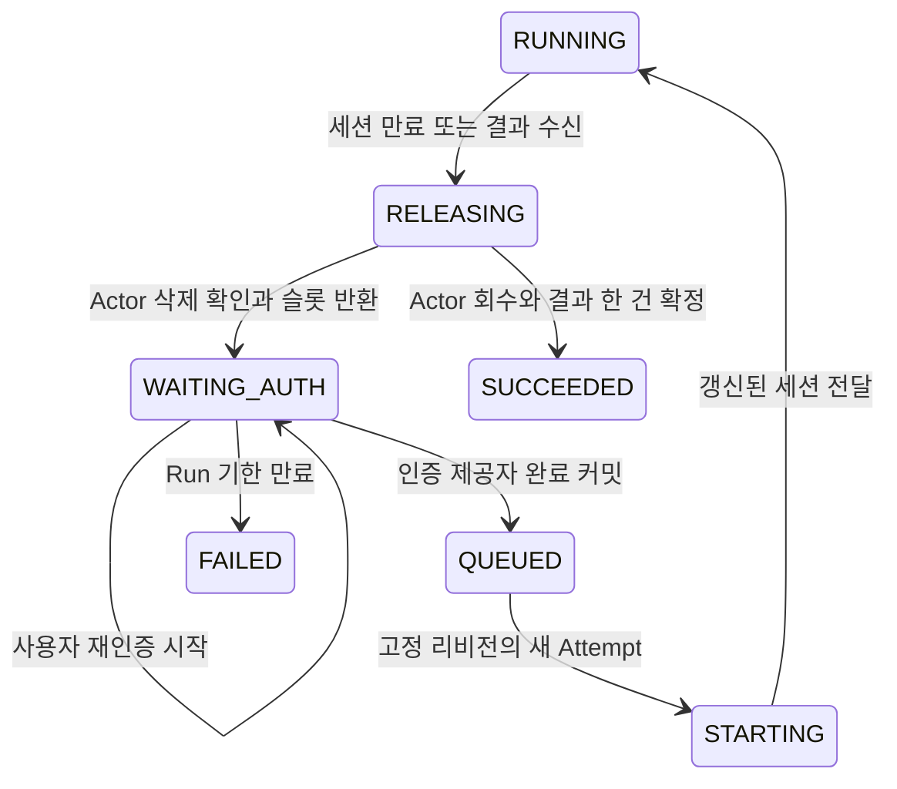

# 사이트 세션과 HITL 재인증

Job 접수 요청의 `Site-Session-Ref`에 운영자가 등록한 사이트 계정 참조를 지정한다. `worker-controller`는 네임스페이스와 HTTPWorker UID에 속하는 세션을 찾아 Run에 연결한다. PostgreSQL에는 로그인 상태를 AES-256-GCM 암호문으로 저장한다. Controller는 실행할 Attempt에만 mTLS로 로그인 상태를 전달하며 상태 조회에는 세션 버전이 표시된다. 같은 DB를 쓰는 컨트롤러는 동일한 키 Secret을 사용한다. [Job API](job-api.md) · [세션 저장소](../internal/jobs/site_sessions.go)



## 러너와 인증 제공자

- 공통 런타임은 사설 `POST /attempt`가 받은 `siteSession`을 앱의 표준 입력으로 전달한다. 앱이 세션 만료를 확인해 종료 코드 `42`를 반환하면 런타임은 HTTP 428과 `{"code":"site_session_expired"}`로 응답한다. Echo 패키지는 승인된 모의 쿠키를 사용한 결과에 `siteSessionVersion`을 남긴다. [Echo 앱](../examples/echo/app/main.go) · [공통 런타임의 요청 처리](../cmd/actor-runtime/runner.go)
- 컨트롤러는 처음 Actor의 삭제가 확인되기 전까지 `RELEASING`을 유지한다. 이후 `GET /v1/runs/{id}`에 `WAITING_AUTH`, `occupiedSlots: 0`, `reauth.requestId`가 표시된다. `occupiedSlots`는 해당 Run에 속한 `STARTING`, `RUNNING`, `RELEASING` Attempt의 수다. Run 기한 안에 인증을 마칠 수 있다.
- 호출자는 Job 토큰으로 `POST /v1/runs/{id}/reauth/{requestId}/start`를 호출한다. 같은 세션의 이미 시작된 갱신이 있으면 `409`를 반환한다. 갱신이 끝난 세션을 사용할 수 있으면 그 버전으로 대기 중인 Run을 다시 큐에 올린다.
- 인증 제공자는 보호된 내부 경로에서 별도 토큰으로 완료를 등록한다. 같은 Run의 활성 요청과 세션 버전을 확인한 후 한 트랜잭션에서 세션을 갱신하고 Run을 재개한다. 이미 완료한 요청은 기존 영수증을 반환한다. [재인증 트랜잭션](../internal/jobs/site_sessions.go)

## 개발계 설정

Job 개발계의 PostgreSQL, ATE Router mTLS, Job 토큰 및 Gateway를 준비한다. `SITE_KEY_FILE`에는 무작위 32바이트를 base64로 인코딩한 값을, `REAUTH_TOKEN_FILE`에는 Job 토큰과 구분된 32자 이상의 무작위 인증 제공자 토큰을 둔다. `CONTROLLER_IMAGE`에는 이 버전의 컨트롤러 이미지 digest를 사용한다. [Job 개발계 가이드](job-api.md#개발계에서-켜기)

```sh
k -n "$ns" create secret generic worker-job-site-sessions \
  --from-file="session-key=$SITE_KEY_FILE" --from-file="provider-token=$REAUTH_TOKEN_FILE"

sed '/-router-url=/c\
            - -router-url=https://wp-echo-example-router.ate-system.svc:443\
            - -router-server-name=atenet-router.ate-system.svc' deploy/controller/deployment.yaml |
  k patch --local -f - --type=json --patch-file examples/echo/jobs-controller-patch.yaml -o yaml |
  k patch --local -f - --type=json --patch-file examples/echo/site-sessions-controller-patch.yaml -o yaml |
  k set image --local -f - controller="$CONTROLLER_IMAGE" -o yaml |
  k -n "$ns" apply -f -
k -n "$ns" rollout status deployment/worker-controller --timeout=90s
```

Job 개발계 가이드의 `apply_job_package "$package_v1"`과 `wait_job_revision`으로 Echo 앱 v1을 게시한다. 이 명세는 공통 런타임 이미지와 OCI 앱 패키지를 지정하고 `spec.jobEnabled`를 켠다. Gateway는 로컬 8080번에, 인증 제공자 접속은 별도 터미널의 `k -n "$ns" port-forward svc/worker-jobs 8084:80`으로 연결한다. 예제 Gateway에 게시하는 Job 경로는 `/v1`이다. [Echo 패키지 빌드와 배포](job-api.md#개발계에서-켜기) · [Gateway 정의](../examples/echo/jobs-gateway.yaml)

## 만료와 모의 재인증 호출

`SITE_EXPIRES_AT`을 미래의 RFC 3339 시각으로 설정한다. 예제는 Echo에서 먼저 거부할 모의 쿠키를 등록하고, 사용자가 재인증을 시작하면 승인된 모의 쿠키로 세션을 갱신한다.

```sh
private=http://127.0.0.1:8084
gateway=http://127.0.0.1:8080
provider="Authorization: Bearer $(cat "$REAUTH_TOKEN_FILE")"
caller="Authorization: Bearer $(cat "$JOB_TOKEN_FILE")"
host='Host: echo.example.test'
json='Content-Type: application/json'

site_state() {
  jq -nc --arg cookie "$1" --arg expires "$SITE_EXPIRES_AT" \
    '{state:{mockCookie:$cookie},expiresAt:$expires}'
}

curl -fsS -H "$provider" -H "$json" --data "$(site_state expired-for-echo)" \
  "$private/internal/v1/workers/echo/site-sessions/demo-account"
receipt="$(curl -fsS -H "$host" -H "$caller" -H "$json" \
  -H 'Site-Session-Ref: demo-account' -H 'Idempotency-Key: site-reauth-1' \
  --data '{"message":"hello"}' "$gateway/v1/workers/echo/runs")"
id="$(printf '%s' "$receipt" | jq -r .runId)"
revision="$(printf '%s' "$receipt" | jq -r .revision)"
curl -fsS -H "$host" -H "$caller" "$gateway/v1/runs/$id"
```

Run이 `WAITING_AUTH`가 되면 동일 Run ID의 상태에서 `requestId`와 슬롯 0개를 확인한다. 대기 중 `appPackage`만 v2로 바꾸면 같은 URL의 동기 Echo 응답이 v2로 바뀐다. Run은 접수한 v1 리비전과 같은 재인증 요청을 유지한다.

```sh
status="$(curl -fsS -H "$host" -H "$caller" "$gateway/v1/runs/$id")"
printf '%s' "$status" | jq -e '.state == "WAITING_AUTH" and .occupiedSlots == 0'
request="$(printf '%s' "$status" | jq -r .reauth.requestId)"
apply_job_package "$package_v2"
wait_job_revision
curl -fsS -H "$host" -H "$json" --data '{"message":"active package"}' \
  "$gateway/invoke" | jq -e '.version == "v2"'
curl -fsS -H "$host" -H "$caller" "$gateway/v1/runs/$id" |
  jq -e --arg revision "$revision" --arg request "$request" \
    '.state == "WAITING_AUTH" and .occupiedSlots == 0 and .revision == $revision and .reauth.requestId == $request'
```

재인증 시작 요청은 Gateway로, 모의 완료는 인증 제공자 접속으로 보낸다. Run이 `SUCCEEDED`가 되면 기존 Run ID로 v1의 새 Attempt 결과를 읽는다.

```sh
curl -fsS -X POST -H "$host" -H "$caller" \
  "$gateway/v1/runs/$id/reauth/$request/start"
curl -fsS -H "$provider" -H "$json" --data "$(site_state approved-for-echo)" \
  "$private/internal/v1/runs/$id/reauth/$request/complete"
curl -fsS -H "$host" -H "$caller" "$gateway/v1/runs/$id"
# SUCCEEDED 확인 후 기존 ID의 결과를 조회한다.
curl -fsS -H "$host" -H "$caller" "$gateway/v1/runs/$id/result" |
  jq -e --arg id "$id" '.runId == $id and .version == "v1" and .attempt == 2 and .siteSessionVersion == 2'
```

## ARM64 gVisor 검증

### 공통 런타임과 Echo 앱 패키지

별도 풀에서 런타임 이미지 digest `sha256:b689b5c190cd…`를 고정하고 앱 패키지 digest만 `148725500732…`에서 `60127c433795…`로 바꿨다. Run `50649c77-9b8f-41e1-8578-d1a7c3f36c74`는 접수 당시의 v1 리비전 `cd2a53755408…`을 유지했다.

| 단계 | 관찰 결과 |
| --- | --- |
| 세션 만료 | 첫 Actor `6573c31b-cd85-4c20-bf40-c24539f7abd0`가 세션 버전 1의 만료를 반환했다. `WAITING_AUTH`에서 ATE의 Job Actor와 API·PostgreSQL의 점유 슬롯은 각각 0개였다. |
| 대기 중 v2 게시 | 같은 Gateway URL이 v2로 응답했다. Run ID, v1 리비전, 재인증 요청이 유지됐다. 재인증을 시작한 뒤에도 Job Actor와 슬롯은 0개였다. |
| 모의 재인증 | 동시 완료 요청 두 건에 같은 영수증이 돌아왔다. 새 Actor `d70cc32a-ac63-4ff6-a32e-0219daafe991`에서 세션 버전 2로 v1 Attempt를 실행했다. |
| 결과 확정 | 동일 Run ID로 결과를 두 번 읽어 `version: v1`, `attempt: 2`, `siteSessionVersion: 2`가 같은지 확인했다. PostgreSQL에 Run 1건, Attempt 2건, 완료 인증 요청 1건, 결과 1건이 남았다. |

### 독립 이미지 검증

별도 풀의 Echo에 모의 세션 버전 1로 Job을 접수했다. Echo가 세션 만료를 반환한 뒤 Run은 `WAITING_AUTH`로 전환됐다. API와 PostgreSQL에서 Run의 점유 슬롯이 0개였고 ATE에서 그 Run의 Actor는 0개였다. 풀의 실제 할당 수는 테스트 HTTP 배포 Actor 한 개가 있던 기준값으로 돌아왔다.

사용자가 재인증을 시작한 상태에서도 슬롯과 Job Actor는 0개였다. 완료 콜백을 동시에 두 번 보내자 두 요청이 같은 완료 영수증을 반환했다. 새 Actor가 세션 버전 2를 사용했고, 최초 Run ID와 리비전으로 결과를 조회했다. PostgreSQL에서 Run 1건, Attempt 2건, 완료 인증 요청 1건, 결과 1건을 확인했다. 시험 DB에 이전 스키마로 저장한 완료 Run의 결과도 마이그레이션 뒤 조회됐다.
